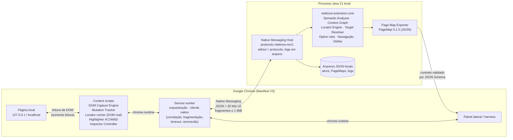
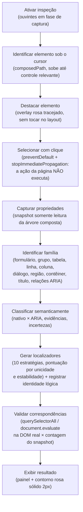
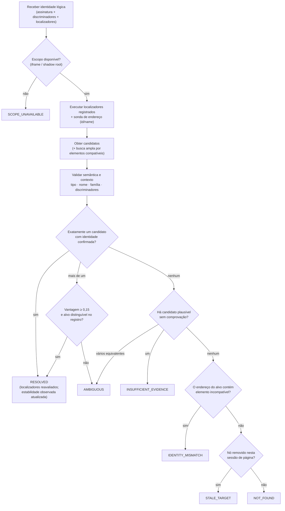

# Nekkora Extension Chrome

Primeira camada de **interpretação estrutural e semântica de páginas web** do **Nekkora Studio**:
uma extensão Chrome (Manifest V3) que observa a página e um **motor Java 21** que classifica elementos,
entende a **família** de cada um, gera **localizadores** com alternativas e **reencontra** alvos após
mudanças na interface — recusando explicitamente qualquer resolução insegura.

> Um elemento não é identificado só pelo que ele é isoladamente, mas pelo que representa, onde está,
> a quais estruturas pertence e quais evidências permitem reencontrá-lo.

| | |
|---|---|
| Missão | NEKKORA-CHROME-001 |
| Estado | Homologação local **aprovada**: 58/58 casos no Chrome real + 140 testes unitários/contrato ([relatório final](reports/final-report.md)) |
| Linguagem principal | Java 21 (motor de análise, host Native Messaging, servidor do laboratório, testes) |
| Navegador | Google Chrome / Chrome for Testing 155 (MV3) |
| Contrato | Nekkora PageMap **0.1.0** ([JSON Schema](contracts/page-map.schema.json)) |

---

## Sumário

1. [Arquitetura](#arquitetura)
2. [Fluxo de inspeção](#fluxo-de-inspeção)
3. [Fluxo de reencontro](#fluxo-de-reencontro)
4. [Pré-requisitos](#pré-requisitos)
5. [Preparação passo a passo](#preparação-passo-a-passo)
6. [Uso](#uso)
7. [Testes](#testes)
8. [Estrutura do repositório](#estrutura-do-repositório)
9. [Contratos](#contratos)
10. [Identidade visual](#identidade-visual)
11. [Permissões e segurança](#permissões-e-segurança)
12. [Solução de problemas](#solução-de-problemas)
13. [Limitações](#limitações)

Documentação detalhada: [arquitetura](docs/architecture.md) · [contratos](docs/contracts.md) ·
[decisões](docs/decisions.md) · [plano de testes](docs/test-plan.md) · [limitações](docs/limitations.md) ·
[relatórios por fase](docs/phase-reports.md).

---

## Arquitetura

A extensão **não executa bytecode Java**. O Chrome cuida do que depende das APIs do navegador
(DOM, eventos, destaque); **todas as regras de análise** ficam no Java, que roda como processo local
iniciado pelo próprio Chrome via **Native Messaging** (sem servidor, sem rede, sem nuvem).



| Responsabilidade | Onde | Linguagem |
|---|---|---|
| DOM Capture Engine | `chrome-extension/src/content/capture.js` | JS (exige API do navegador) |
| Mutation Tracker (lotes → deltas) | `chrome-extension/src/content/mutation-tracker.js` + `core/mutation` | JS + Java |
| Semantic Analyzer | `java-core/core/.../semantic` | Java |
| Context Graph (família) | `java-core/core/.../context` | Java |
| Locator Engine | `java-core/core/.../locator` | Java (verificação ao vivo em JS) |
| Target Resolver | `java-core/core/.../resolve` + `identity` | Java |
| Inspector Controller + destaque | `chrome-extension/src/content/inspector.js`, `highlighter.js` | JS |
| Page Map Exporter | `java-core/core/.../pagemap` | Java |
| Native Messaging Host | `java-core/native-host` | Java |
| Laboratório | `java-core/lab-server` + `test-lab/pages` | Java + HTML |

## Fluxo de inspeção

Implementado em `inspector.js` → `service-worker.js#selectNode` → comandos `snapshot.submit`,
`element.inspect`, `target.register`, `locators.verify` do host.



## Fluxo de reencontro

Implementado em `TargetResolver` (`java-core/core/.../resolve`). Um seletor que retorna um elemento
**não** é uma resolução: cada candidato é confrontado com a identidade registrada.



Nunca se escolhe o índice zero: com dois candidatos igualmente plausíveis o resultado é `AMBIGUOUS`.

---

## Pré-requisitos

| Ferramenta | Versão validada | Uso |
|---|---|---|
| JDK | **21** (Microsoft OpenJDK 21.0.12) | compilar e executar o motor, o host e o laboratório |
| Maven | via wrapper `mvnw` (3.9.11, baixado automaticamente) | build — não é preciso instalar |
| Google Chrome | 116+ (para uso manual) | carregar a extensão |
| Chrome for Testing | 155 (baixado automaticamente em `.tools/`) | testes no navegador |
| Windows PowerShell | 5.1+ | scripts de instalação/execução |
| Node.js (opcional) | 20+ (validado 24.19) | somente testes unitários da extensão; a extensão **não** tem etapa de build |

Sistema operacional validado: **Windows 11**. Linux/macOS: ver [limitações](docs/limitations.md).

## Preparação passo a passo

1. **Clonar**
   ```powershell
   git clone https://github.com/Nekkora-Operation/Nekkora-Extension-Chrome.git
   cd Nekkora-Extension-Chrome
   ```
2. **Instalar dependências** — nada a instalar manualmente: o wrapper Maven baixa Maven e bibliotecas.
3. **Compilar o motor Java** (e rodar os testes unitários):
   ```powershell
   .\scripts\build.ps1            # ou: .\mvnw.cmd install
   ```
4. **Compilar a extensão** — não há compilação: `chrome-extension/` é carregada como está (JS puro).
5. **Registrar o Native Messaging Host** (somente usuário atual, sem administrador):
   ```powershell
   .\native-host\scripts\install-host.ps1
   ```
   Gera `%LOCALAPPDATA%\Nekkora\ExtensionChrome\host\` (JAR, `nekkora-host.cmd`, manifesto) e registra
   `HKCU\Software\Google\Chrome\NativeMessagingHosts\com.nekkora.extension_chrome` e
   `HKCU\Software\Chromium\...` (lida também pelo Chrome for Testing).
6. **Configurar o ID autorizado da extensão** — automático: o `manifest.json` contém a chave pública,
   que fixa o id **`dceigcmhbihcigneokmpmbocdclkhcaj`**; o instalador calcula o id a partir dela e o
   grava em `allowed_origins`. Para forçar outro id: `install-host.ps1 -ExtensionId <id>`.
7. **Carregar a extensão no Chrome**: `chrome://extensions` → ativar *Modo do desenvolvedor* →
   *Carregar sem compactação* → selecionar a pasta `chrome-extension/`. Confirme que o id exibido é o do
   passo 6.
8. **Iniciar o laboratório**:
   ```powershell
   .\scripts\start-lab.ps1        # http://127.0.0.1:8765/lab/index.html
   ```
9. **Executar uma inspeção**: abra uma página do laboratório → clique no ícone **N** (abre o painel
   lateral) → *Ativar inspeção* → passe o mouse (contorno rosa tracejado) → clique no elemento
   (contorno rosa sólido; a ação do elemento não é executada) → o painel mostra tipo, nome, família,
   localizadores com contagens no snapshot e na DOM real.
10. **Exportar um PageMap**: no painel, *Exportar mapa* → baixa `pagemap-<captura>.json`; uma cópia fica
    em `%LOCALAPPDATA%\Nekkora\ExtensionChrome\pagemaps\`.

Remover o host: `.\native-host\scripts\uninstall-host.ps1` (`-RemoveData` apaga também dados e logs).

## Uso

Ações do painel lateral (`src/ui/panel.html`):

| Botão | O que faz |
|---|---|
| Ativar inspeção | contorno rosa ao passar o mouse; clique seleciona sem disparar a ação |
| Desativar inspeção | remove ouvintes, observadores, overlay e laço de acompanhamento |
| Capturar página | captura estrutural (somente leitura) + análise no Java; mostra cobertura e limites |
| Testar reencontro | reexecuta a resolução do alvo selecionado e destaca o resultado (ou mostra a recusa) |
| Comparar snapshots | compara a captura anterior com uma nova (adicionados, removidos, alterados, re-renderizados) |
| Exportar mapa | gera o PageMap 0.1.0 |
| Acompanhar mutações | liga o Mutation Tracker (deltas incrementais; o destaque segue re-renderizações) |

## Testes

| Suíte | Comando | Navegador |
|---|---|---|
| Unitários Java (core 113, host 12, laboratório 3) + contrato (2) | `.\mvnw.cmd test` | não |
| Unitários da extensão (10) | `cd chrome-extension; npm test` | não |
| Homologação no Chrome real (58 casos) | `.\scripts\run-tests.ps1 -Suite integration` | sim (Chrome for Testing) |
| Tudo + relatórios | `.\scripts\run-tests.ps1` | sim |
| Somente algumas classes | `.\scripts\run-tests.ps1 -Suite integration -Test "NegativeCasesIT,ResolutionIT"` | sim |
| Sem janela | acrescente `-Headless` | sim |

Relatórios gerados pela execução real:

- [`reports/test-matrix-integration.md`](reports/test-matrix-integration.md) — matriz T001–T040, casos negativos N-A..N-E, comunicação e contratos;
- [`reports/performance.md`](reports/performance.md) — medições de 100 a 10.000 elementos e de mutações frequentes;
- [`reports/evidence/`](reports/evidence) — capturas de tela do destaque rosa, do painel e da inspeção sem ação acidental;
- [`reports/final-report.md`](reports/final-report.md) — relatório de homologação.

Os testes de integração instalam o host com o script oficial, iniciam o laboratório, baixam o
Chrome for Testing (o Chrome de marca ignora `--load-extension` desde a versão 137), carregam a
extensão e isolam os dados do host em `integration-tests/target/host-data`.

## Estrutura do repositório

```text
Nekkora-Extension-Chrome/
├── pom.xml, mvnw, mvnw.cmd          build Maven multi-módulo (Java 21)
├── java-core/
│   ├── core/          motor de domínio (sem dependências de runtime)
│   ├── native-host/   host Native Messaging (Jackson; JAR único)
│   └── lab-server/    servidor do laboratório (JDK puro)
├── chrome-extension/  extensão MV3 (JS puro, sem bundler) + testes Node
├── native-host/       scripts de instalação/remoção do host
├── contracts/         JSON Schemas: PageMap, snapshot bruto, protocolo
├── test-lab/pages/    páginas do laboratório (simples, intermediárias, complexas)
├── integration-tests/ homologação no Chrome real + testes de contrato
├── scripts/           build, laboratório, testes
├── docs/              arquitetura, contratos, decisões, plano de testes, limitações, fases
└── reports/           matriz, desempenho, evidências e relatório final
```

## Contratos

- **PageMap 0.1.0** — [`contracts/page-map.schema.json`](contracts/page-map.schema.json): `PageSnapshot`,
  `DocumentContext`, `ElementDescriptor`, `ElementFamily`, `ContextRelation`, `LocatorDescriptor`,
  `TargetIdentity`, `ResolutionResult`, `CoverageReport`, `MutationRecord`, `InspectionEvidence`.
- **Snapshot bruto** — [`contracts/raw-snapshot.schema.json`](contracts/raw-snapshot.schema.json).
- **Protocolo nekkora-nm/1** — [`contracts/native-protocol.schema.json`](contracts/native-protocol.schema.json).

`nodeId` é **temporário** (vale na sessão de página indicada por `pageSessionId`); `targetId` é a
**identidade lógica** e nunca se liga permanentemente a um nó DOM. Detalhes em [docs/contracts.md](docs/contracts.md).

## Identidade visual

O rosa oficial foi **confirmado** em `Nekkora-Operation/Nekkora-lib`, `src/tokens/themes.css`:
`--nk-color-accent` (tema light) e `--nk-solid-accent` (tema dark) = **`#C2466D`**. Os tokens da
extensão estão centralizados em [`chrome-extension/src/shared/tokens.js`](chrome-extension/src/shared/tokens.js).
Somente **valores** de tokens foram reutilizados; nenhum código, logo ou imagem proprietária foi
copiado (o ícone "N" é um marcador simples criado para esta extensão).

O destaque é um **overlay independente** (shadow root fechado, `position: fixed`, `pointer-events: none`)
com borda de 2 px a 2 px do elemento — o mesmo efeito de `outline: 2px solid; outline-offset: 2px` sem
alterar estilo ou layout da página ([evidência](reports/evidence/T034-highlight-zoom.png)).

## Permissões e segurança

| Permissão | Motivo |
|---|---|
| `host_permissions: http://127.0.0.1/*, http://localhost/*` | atuar **somente** em páginas locais (sem `<all_urls>`) |
| `nativeMessaging` | falar com o host Java local |
| `sidePanel` | painel lateral |
| `storage` | última inspeção por aba (`storage.session`) |
| `scripting` | ler hooks de teste **declarados** pelas páginas do laboratório (lista fechada, somente leitura) |
| `webNavigation` | detectar navegação SPA (`pushState`/hash) em páginas locais |

- Valores de campos **nunca** saem da página, exceto campos de pesquisa reconhecidos (`type=search` ou
  `name` de pesquisa); senhas/cartões/documentos são marcados como sensíveis e nunca exportados (T033).
- O content script recusa origens não locais mesmo que o manifesto mude (defesa em profundidade).
- Funções da página só são lidas se a página declarar `window.nekkoraTestHooks.__nekkoraLab === true`
  e apenas os nomes da lista permitida; funções fora da lista nunca são chamadas (T038).
- `stdout` do host é exclusivo do protocolo; logs vão para `%LOCALAPPDATA%\Nekkora\ExtensionChrome\logs`.
- Nenhum servidor remoto, nenhuma telemetria, nenhum banco oficial da Nekkora.

## Solução de problemas

| Sintoma | Causa provável | Correção |
|---|---|---|
| `java` não encontrado / *Java 21+ não encontrado* | JDK ausente ou fora do PATH | instale um JDK 21 e defina `JAVA_HOME`, ou `install-host.ps1 -JavaExe C:\caminho\java.exe` |
| Erro de compilação `release 21` | JDK anterior ao 21 em `JAVA_HOME` | aponte `JAVA_HOME` para o JDK 21 (`java -version`) |
| Painel: *host indisponível* / `HOST_UNAVAILABLE: Specified native messaging host not found` | host não registrado para este navegador | rode `install-host.ps1`; confira `reg query "HKCU\Software\Google\Chrome\NativeMessagingHosts\com.nekkora.extension_chrome"`. Chrome for Testing/Chromium leem `HKCU\Software\Chromium\...` |
| `Access to the specified native messaging host is forbidden` | id da extensão diferente do `allowed_origins` | o id em `chrome://extensions` deve ser `dceigcmhbihcigneokmpmbocdclkhcaj`; se carregou outra cópia, rode `install-host.ps1 -ExtensionId <id>` |
| `HOST_DISCONNECTED: Native host has exited` | o processo Java terminou (ex.: Java errado no `nekkora-host.cmd`) | veja `%LOCALAPPDATA%\Nekkora\ExtensionChrome\logs\native-host-0.log`; reinstale o host |
| `ORIGIN_NOT_ALLOWED` | página fora de 127.0.0.1/localhost | a extensão atua só no laboratório local (por projeto) |
| Testes: falha ao baixar o Chrome for Testing | sem acesso a `googlechromelabs.github.io` / `storage.googleapis.com` | baixe manualmente e use `-Dnekkora.cft.version=<versão>` com os arquivos em `.tools/chrome-for-testing/<versão>/` |
| Testes: *session not created* (ChromeDriver incompatível) | `.tools` com versões misturadas | apague `.tools/chrome-for-testing` e rode novamente |
| Testes: *content script pronto* não atingido / laboratório não iniciado | porta 8765 ocupada | libere a porta ou use `-Dnekkora.lab.port=<porta>` |
| Extensão não carrega | pasta errada | selecione `chrome-extension/` (onde está o `manifest.json`); Chrome 116+ |
| Script PowerShell bloqueado | política de execução | `powershell -ExecutionPolicy Bypass -File <script>` |

## Limitações

Resumo (lista completa e evidências em [docs/limitations.md](docs/limitations.md)):

- Shadow DOM **fechado** é detectado mas não inventariado; iframes cross-origin/sandbox são declarados inacessíveis.
- Instalação do host automatizada e validada apenas no **Windows**; uso com o Chrome de marca foi
  preparado (chave de registro e carga manual), mas a automação de testes usa o Chrome for Testing.
- Nome acessível segue AccName de forma simplificada; heurísticas (erro, instrução, portal, virtualização) estão rotuladas como tal.
- Shadow roots/iframes criados **depois** de ligar o rastreamento só entram na cobertura após nova captura completa.
- Exploração de opções (abrir dropdowns) é etapa separada feita por clique do usuário/teste — a extensão não clica sozinha.
- Licenciamento ainda **não definido** ([LICENSE](LICENSE)).

