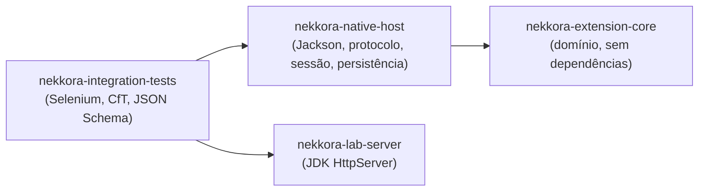
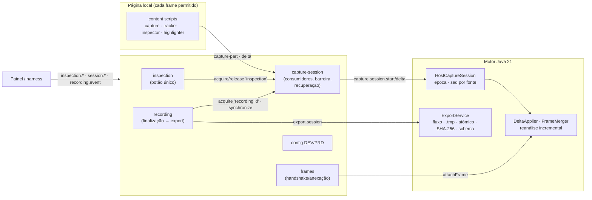
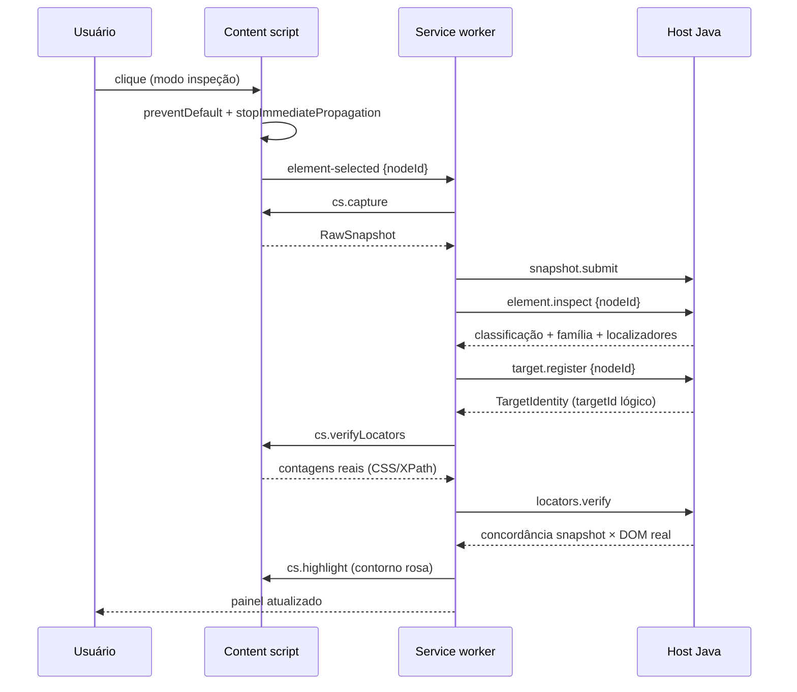
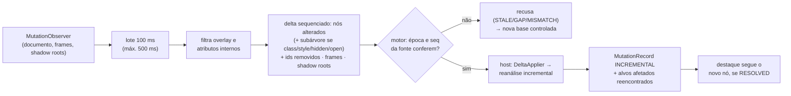
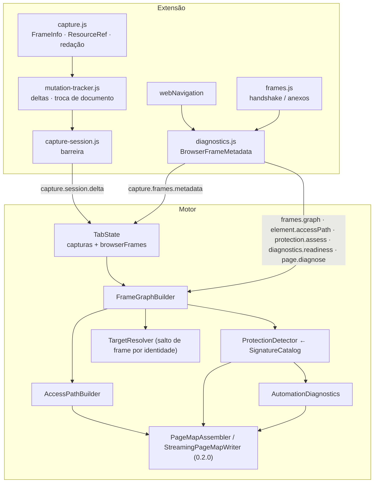
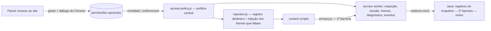

# Arquitetura

## Visão geral

Dois ambientes, com uma fronteira explícita:

| Ambiente | Responsabilidades | Por quê |
|---|---|---|
| **Chrome** (content scripts + service worker, JS puro) | ler a DOM, observar mutações, executar localizadores na DOM real, destacar, interceptar eventos de inspeção, ler hooks de teste declarados, falar com o host | dependem de APIs do navegador; extensões não executam bytecode Java |
| **Java 21** (processo local via Native Messaging) | classificar, montar a família, gerar e pontuar localizadores, registrar identidades, resolver alvos, comparar capturas, aplicar deltas, interpretar URL, analisar interações, montar e persistir o PageMap | núcleo determinístico, testável sem navegador, reutilizável pelo Nekkora Studio |

O JavaScript nunca decide classificação, família, estabilidade ou resolução.

## Módulos Java

### `nekkora-extension-core` — pacotes

| Pacote | Responsabilidade (SRP) |
|---|---|
| `snapshot` | modelo de entrada (`RawSnapshot`, `RawNode`, `NodeState`) e `PageModel` indexado (ordem DFS composta, subárvores, escopos, índices por id/tag) |
| `text` | normalização em camadas (`normalize` preserva identidade; `fold`/`maskDigits` só para comparação) |
| `semantic` | `SemanticClassifier` (nativo × ARIA, evidências, incertezas), `AccessibleNameCalculator`, `SensitivityPolicy`, condições |
| `context` | `ContextGraph`: família (`ElementFamily`), relações declaradas/inferidas (`ContextRelation`) |
| `locator.query` | localizador estruturado (`LocatorQuery` → passos → predicados), avaliador no snapshot, renderização CSS/XPath |
| `locator.strategy` | estratégias plugáveis (`LocatorStrategy`) e fábrica de passos |
| `locator` | `LocatorEngine` (pontuação), estabilidade heurística × observada, descritores |
| `identity` | assinatura, discriminadores, comparação de características, `TargetIdentity` |
| `resolve` | `TargetResolver` e `ResolutionResult` |
| `options` | conjuntos de opções (select, combobox, listbox, portal, dinâmico, virtualizado) |
| `navigation` | contexto de URL (observado × inferido) e diferenças |
| `mutation` | deltas incrementais, comparação de capturas, `MutationRecord` |
| `interaction` | antes/depois de interações com fonte de cada fato (URL, DOM, Resource Timing, instrumentação) |
| `coverage` | cobertura e limites declarados |
| `pagemap` | montagem do PageMap 0.1.0 |
| `analysis` | fachada `PageAnalyzer` (snapshot → análise; reanálise incremental) |

### SOLID na prática

- **S** — cada pacote acima tem uma razão para mudar; o host separa protocolo (`protocol`), mapeamento JSON (`json`), estado (`session`), persistência (`persistence`) e comandos (`commands`, um grupo por assunto).
- **O** — nova estratégia de localização = nova classe que implementa `LocatorStrategy` registrada em `LocatorEngine.defaultStrategies()`; novo comando = novo `CommandGroup`. Motor e roteador não mudam.
- **L** — todas as estratégias respeitam o contrato "propor apenas localizadores que incluem o alvo; não decidir o melhor"; o motor descarta propostas que violam o contrato.
- **I** — interfaces pequenas: `LocatorStrategy`, `CommandHandler`, `CommandGroup`, `StabilityObservations`.
- **D** — o domínio não conhece Chrome, Jackson, Selenium nem banco: anotações de polimorfismo JSON vivem em *mix-ins* no host (`JsonCodec`); a extensão só conhece o protocolo.

## Extensão (MV3)

| Arquivo | Papel |
|---|---|
| `content/capture.js` | DOM Capture Engine: árvore composta em pré-ordem; estados (`checkVisibility`, `:disabled`, `:modal`, inércia); shadow roots abertos inventariados, fechados detectados via `chrome.dom.openOrClosedShadowRoot`; iframes acessíveis percorridos, inacessíveis declarados |
| `content/node-registry.js` | ids temporários por `WeakMap`/`WeakRef` (sem reter nós destruídos) e `pageSessionId` |
| `content/sensitivity.js` | política de privacidade aplicada no navegador |
| `content/mutation-tracker.js` | `MutationObserver` por raiz observável; modo BUFFER durante a captura-base; lotes (100 ms / máx. 500 ms); deltas sequenciados `{sessionId, source, epoch, seq}` um por vez; pausa em falha; reconciliação de shadow roots (1 s); geometria em rolagem/redimensionamento e na barreira |
| `content/locator-runner.js` | executa CSS/XPath na DOM real, atravessando a cadeia de escopos |
| `content/highlighter.js` | overlay com shadow root fechado; acompanha por `requestAnimationFrame` só enquanto há destaque; detecta desconexão do alvo |
| `content/inspector.js` | modos OFF/INSPECT; bloqueio de `pointerdown/mousedown/mouseup/click/submit…` em fase de captura |
| `content/content-main.js` | comandos `cs.*`: captura avulsa, sessão (`begin/confirmBase/flush/pause/navigation/stop/status`), handshake de frames (`announce/lookup`), inspeção, destaque, verificação |
| `background/runtime.js` | cliente nativo compartilhado, mensagens por frame, difusão (com limite de frequência), política de origem, exclusão mútua por aba |
| `background/capture-session.js` | **CaptureSession** por aba: consumidores, captura-base cooperativa em partes, deltas, barreira, ressincronização limitada, reconexão do motor, restauração após reinício do service worker |
| `background/frames.js` | iframes de outra origem permitida: handshake, anexação (`capture.session.attachFrame`), política de sandbox |
| `background/inspection.js` | **InspectionSession**: botão único (estados), seleção reutilizando o snapshot sincronizado, reencontro, destaque comprovado |
| `background/recording.js` | contrato `recording.session.started/finished/cancelled` → exportação idempotente |
| `background/config.js` | modo DEV/PRD (construção) e bloqueio dos comandos DEV em PRD |
| `background/session-store.js` | estado mínimo em `chrome.storage.session` |
| `background/native-client.js` | cliente nekkora-nm/1: correlação, fragmentação, timeout, reconexão com espera progressiva, aviso de conexão perdida |
| `background/service-worker.js` | roteamento: eventos dos content scripts, comandos das páginas da extensão (novos e da CHROME-001), SPA, abas fechadas |
| `ui/panel.*` | painel lateral: botão único, status da captura, área DEV (removida em PRD) |
| `ui/harness.*` | página interna usada pelos testes automatizados (simula eventos de gravação; abre o painel nativo) |

### Visão CHROME-002

## Sequência de uma seleção

Sem sessão (fluxo CHROME-001) a seleção faz uma captura avulsa, como abaixo. Com sessão ativa
(CHROME-002) o passo `cs.capture`/`snapshot.submit` é substituído pela **barreira de sincronização**
(`cs.session.flush` em todos os frames) + `capture.pin` — ver [inspeção](chrome-002/inspection.md).

## Atualização incremental

## Persistência

Arquivos JSON locais (`%LOCALAPPDATA%\Nekkora\ExtensionChrome` ou `NEKKORA_DATA_DIR`):
`targets/registry-v2.json` (CHROME-SECURITY-001; o antigo `targets/registry.json` não é lido nem apagado — limpeza
em `docs/chrome-security-001/storage-and-retention.md`), `pagemaps/<captura>.json` (exportação manual) e
`pagemaps/<sessão>-<operação>.json` (exportação da gravação, escrita atômica), `logs/native-host-*.log`. PostgreSQL não é usado
(decisão D-006).

## CHROME-003 — Frame Intelligence e diagnóstico

Novos pacotes do motor (sem dependências de runtime): `core/frames` (`UrlSanitizer`, `BrowserFrameMetadata`,
`FrameIdentity`/`FrameIdentities`, `FrameDescriptor`, `DocumentDescriptor`, `FrameGraph`, `FrameGraphBuilder`,
`ElementAccessPath`, `AccessPathBuilder`), `core/protection` (`SignatureCatalog`, `ProtectionDetector`,
`ProtectionAssessment`, `ProtectionEvidence`, `ProtectionReport`) e `core/diagnostics` (`AutomationDiagnostics`,
`AutomationObstacle`, `AutomationReadinessAssessment`). No host: `FrameCommands`, `CatalogLoader` (catálogo
empacotado de `contracts/`) e as novas seções no `StreamingPageMapWriter`. Na extensão: `background/diagnostics.js`
(metadados do Chrome e comandos), handshake no dono da captura (`frames.js`), detecção de troca de documento de
iframe (`mutation-tracker.js`), recursos observáveis e redação de URLs (`capture.js`) e as seções TRAJETÓRIA e
DIAGNÓSTICO do painel.

Responsabilidade única: o grafo não conhece proteções; o detector não conhece o painel; a prontidão só combina
resultados. As regras ficam no Java; o JavaScript coleta o que só o navegador sabe (DOM vivo, `webNavigation`,
Resource Timing) — nenhuma regra é duplicada (§33).

## NEKKORA-REAL-001 — sites externos autorizados

- `background/access-policy.js`: única decisão de origem (laboratório, autorizada, recusada com motivo).
- `background/injection.js`: content scripts nas origens autorizadas, sem duplicidade.
- `shared/privacy.js` e `core/privacy`: política de privacidade espelhada (vetores em `contracts/privacy/`).
- Tracker: atualizações compactas de geometria e varredura de visibilidade para subárvores grandes.
