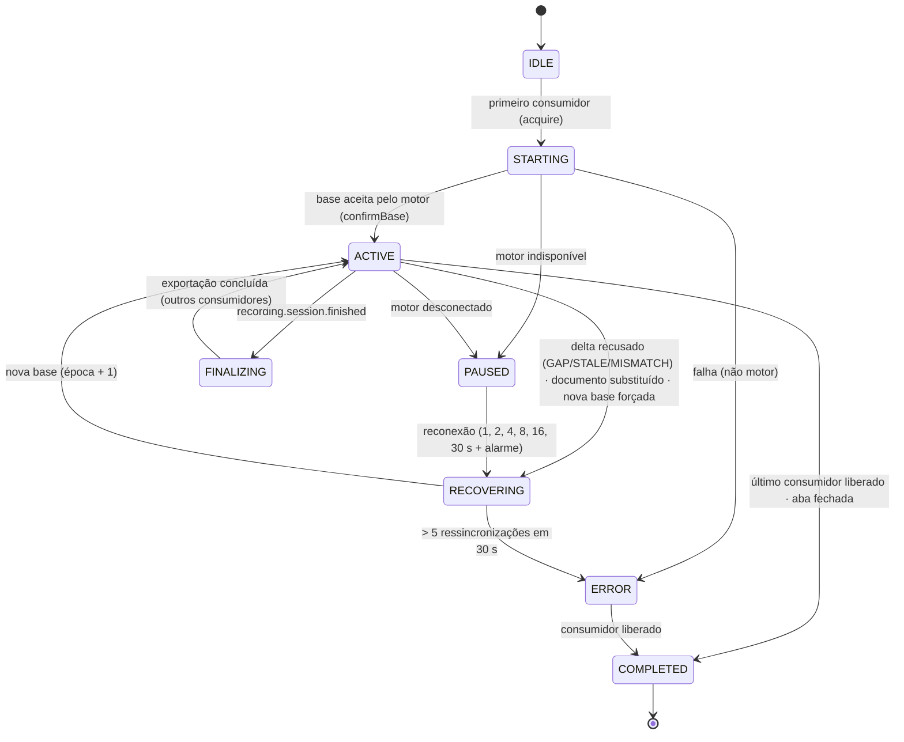

# Ciclo de captura contínua (CHROME-002)

Este documento descreve como a extensão mantém, **sem recapturas completas periódicas**, uma
representação atualizada da página enquanto a inspeção (ou uma gravação) estiver ativa: sessões por
aba, rastreamento incremental, barreira de sincronização, recuperação de falhas e retenção.

Código: `chrome-extension/src/background/capture-session.js` (navegador),
`chrome-extension/src/content/mutation-tracker.js` + `capture.js` (página),
`java-core/native-host/.../capture/HostCaptureSession.java` + `commands/SessionCommands.java` (motor).

## Conceitos separados

| Conceito | Responsabilidade | Onde vive |
|---|---|---|
| **CaptureSession** | base + deltas de UMA aba; consistência; recuperação | service worker (estado) + motor Java (autoridade de ordem) |
| **InspectionSession** | ouvintes de mouse/clique, destaque, seleção; botão único | service worker (`inspection.js`) + content script (`inspector.js`) |
| **Gravação** (futuro Studio) | consome a captura; finaliza com exportação | contrato `recording.session.*` (`recording.js`) |

A CaptureSession é **compartilhada por consumidores** (`inspection`, `recording:<id>`, `tracking`
legado, `manual`). Ela começa no primeiro consumidor e termina quando o último a libera. Por isso:

- desativar a inspeção **não** encerra uma gravação em andamento (C002-049);
- finalizar a gravação libera somente o consumidor da gravação;
- fechar a aba ou "desligar tudo" (`page.disable`) encerra a sessão independentemente dos consumidores.

## Estados da sessão de captura

Persistido em `chrome.storage.session` (somente identificadores, estados e contadores — nunca
conteúdo da página): `sessionId`, `status`, `consumers`, `documentId`, `url`, `epoch`, `startedAt`,
contadores.

## Captura-base cooperativa

1. `cs.session.begin`: o content script liga os observadores em modo **BUFFER** (mutações durante a
   travessia são acumuladas, não perdidas) e percorre a árvore composta em **fatias de 8 ms**,
   cedendo a thread entre elas (`scheduler.yield`/`MessageChannel`).
2. Os nós são entregues em **partes de 1.000** (`capture-part`), cada uma confirmada pelo service
   worker (controle de fluxo); o snapshot montado segue `raw-snapshot.schema.json`.
3. `capture.session.start` no motor: análise completa, a base vira a captura de **referência**
   (`capture.pin`) e a **época** é incrementada (sequências zeradas).
4. `cs.session.confirmBase(época)`: o acumulado durante a travessia vira o **delta #1**.

Política de consistência declarada: **BASE_PLUS_DELTA** — a base não é um instante único; o estado
consistente é "base + primeiro delta" (C002-039: 60 inserções durante a travessia → base + deltas =
captura completa, 9.572 nós nos dois).

## Deltas sequenciados

Cada delta carrega `{sessionId, source, epoch, seq}` (contrato `SequencedDelta` em
`contracts/capture-session.schema.json`). O motor aceita somente `epoch` = época corrente e
`seq` = último aceito + 1 **por fonte** (`top` ou `x<frameId>`); caso contrário recusa com
`DELTA_STALE`, `DELTA_GAP`, `DOCUMENT_MISMATCH`, `FRAME_NOT_ATTACHED` ou `SESSION_STOPPED`, sem
alterar o estado confirmado.

- lotes: espera de 100 ms, no máximo 500 ms desde a primeira mutação; um delta por vez (o próximo só
  sai após a confirmação do anterior);
- um delta acima de 5.000 nós ou mais de 50.000 elementos pendentes ⇒ ressincronização controlada
  (sem crescimento ilimitado de memória);
- mutações do overlay da extensão e atributos `data-nekkora*` são ignorados;
- **geometria**: deslocamentos de layout (rolagem, redimensionamento, conteúdo inserido acima) não
  são mutações DOM. O rastreador recompara retângulos e "dentro do viewport" após rolagem/redimensionamento
  (300 ms) e **na barreira de exportação**, enviando somente os elementos alterados (C002-045);
- SPA: `webNavigation.onHistoryStateUpdated`/`onReferenceFragmentUpdated` ⇒ delta com
  `navigationKind` `SPA_ROUTE`/`FRAGMENT` e a URL nova — a base válida é preservada (C002-016).

## Barreira de sincronização

`synchronize(tab)` envia o pendente de **todos os frames anexados** (`cs.session.flush`) e aguarda a
confirmação do motor. Resultado: `SYNCHRONIZED`, `PENDING`, `DEGRADED`, `NO_SESSION` ou `ERROR`.
É usada antes de **selecionar** (sem captura completa: C002-010/011), comparar, exportar e finalizar.

## Recuperação

| Falha | Detecção | Reação | Teste |
|---|---|---|---|
| Delta perdido | `DELTA_GAP` no motor | nova base (época + 1); limite de 5 em 30 s ⇒ `ERROR` sem laço | C002-017 |
| Motor encerrado | `onDisconnect` da porta nativa | `PAUSED`/`DEGRADED`; rastreadores pausados; reconexão progressiva + `chrome.alarms`; nova base ao voltar | C002-018 |
| Reinício do service worker | estado em `storage.session` | restauração imediata; reconciliação: aba fechada ⇒ descarte; senão nova base (o processo do motor termina com a porta) sem observadores duplicados (`prepare` desliga os anteriores) | C002-019 |
| Recarga / documento substituído | `content-ready` com outro `pageSessionId` | nova base na mesma sessão; inspeção reinstalada | C002-015 |
| Aba fechada | `tabs.onRemoved` | sessão encerrada no navegador e no motor (`capture.session.stop` + `release`) | C002-042 |
| Rastreador órfão | delta de sessão inexistente | `cs.session.stop` no frame | — |

## Retenção e limites

| Item | Limite | Motivo |
|---|---|---|
| Capturas por aba no motor | 3 (LRU) + 1 referência fixada | cada delta gera uma captura; a referência mantém a base de comparação |
| Pendências no content script | 50.000 elementos | acima disso: ressincronização |
| Delta | 5.000 nós | acima disso: ressincronização |
| Ressincronizações | 5 em 30 s | acima disso: `ERROR` (sem laço) |
| Frames anexados por aba | 20 | proteção |
| Resultados de gravação memorizados | 50 | idempotência |
| Log de eventos do service worker | 200 | diagnóstico |
| Registro de ids no content script | varredura a cada 50 deltas | sessões longas |

Encerrar a sessão libera capturas, histórico de opções, mutações, evidências e resoluções da aba no
motor (`TabState.release`), verificado por `host.memory` (C002-020, C002-040).
