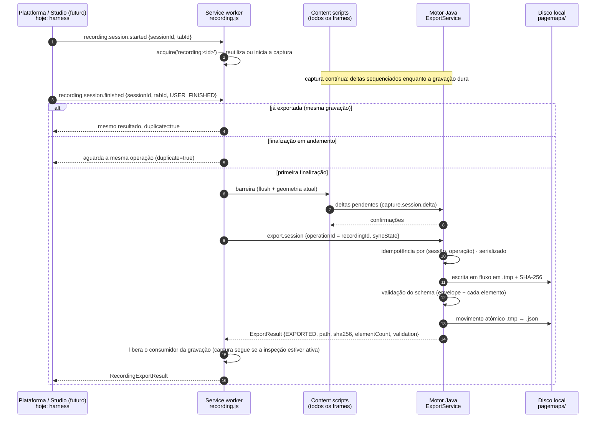

# Exportação automática do PageMap (CHROME-002)

"Exportar" significa **sincronizar, consolidar, validar e persistir** o PageMap 0.1.0 no diretório do
motor Java — não é um download e não é disparado por "Desativar inspeção".

## Contrato de finalização (integração futura com Studio/Platform)

Eventos (contrato `RecordingEvent` em `contracts/capture-session.schema.json`), hoje emitidos pelo
**harness interno** da extensão (simulação; nenhum gravador foi implementado):

```json
{ "type": "recording.session.started",  "sessionId": "rec-123", "tabId": 15 }
{ "type": "recording.session.finished", "sessionId": "rec-123", "tabId": 15, "reason": "USER_FINISHED" }
{ "type": "recording.session.cancelled","sessionId": "rec-123", "tabId": 15 }
```

Resultado de `finished` (contrato `RecordingExportResult`):

| Campo | Significado |
|---|---|
| `recordingId`, `sessionId`, `tabId` | gravação, sessão de captura e aba |
| `status` | `EXPORTED` (completo, memorizado), `PARTIAL` (incompleto, não memorizado) ou `FAILED` |
| `schemaVersion` | `0.1.0` |
| `captureId`, `elementCount` | captura consolidada e elementos no arquivo (iguais ao conteúdo, verificado) |
| `path` | arquivo final em `<dados>/pagemaps/` (`null` em falha) |
| `complete`, `coverage` | completude e limitações declaradas |
| `syncState` | estado da barreira (`SYNCHRONIZED` esperado) |
| `validation` | validação contra `page-map.schema.json` |
| `errors` | lista de erros (vazia no sucesso) |
| `sha256`, `bytes` | checksum e tamanho do arquivo escrito |
| `duplicate` | `true` quando a mesma finalização já tinha sido concluída |

## Fluxo da exportação futura



## Garantias e falhas tratadas

| Situação | Comportamento | Teste |
|---|---|---|
| Sincronização não confirmada (alguma fonte sem confirmação) | `FAILED` + `SYNC_INCOMPLETE` com as fontes não confirmadas; nada é exportado nem memorizado; a gravação continua e pode ser finalizada de novo. O motor também recusa a finalização FINAL sem `SYNCHRONIZED` (`SYNC_NOT_CONFIRMED`) | C002-R02, `SessionCommandsTest` |
| Exportação incompleta (truncada) ou de diagnóstico (`mode: DIAGNOSTIC`) | `PARTIAL`, arquivo distinto `…-partial.json`, `complete=false`, **nunca** memorizada como concluída | `SessionCommandsTest` |
| Reinício do service worker com gravação em andamento | registro da gravação persistido em `storage.session` e restaurado; a finalização funciona normalmente | C002-R03 |
| Finalização × cancelamento simultâneos | eventos da mesma gravação serializados: um único desfecho (exportada **ou** cancelada); cancelar depois de exportar não desfaz a exportação | C002-R05 |
| Muitas gravações | a retenção (50) descarta somente registros encerrados; gravações ativas nunca são descartadas | C002-R06 |
| Alvos de outras abas na mesma URL | cada alvo tem dono (aba + sessão de captura); a exportação inclui somente os alvos da própria sessão | C002-R04, `SessionCommandsTest` |
| Finalização repetida | mesmo resultado, `duplicate=true`, nenhum arquivo novo | C002-023 |
| Finalizações simultâneas | uma exportação; a outra recebe o mesmo resultado | C002-023, `SessionCommandsTest` |
| Delta pendente / alteração imediatamente antes | incluída pela barreira | C002-024 |
| Falha de escrita | `FAILED` + `EXPORT_WRITE_FAILED`; **não memorizada**: nova tentativa exporta; sem `.tmp` residual | C002-025 |
| Sessão inexistente / gravação desconhecida | `FAILED` + `RECORDING_UNKNOWN` | C002-023 |
| Aba fechada antes de finalizar | `FAILED` + `SNAPSHOT_MISSING` | C002-025 |
| Violação do contrato | `FAILED` + `CONTRACT_VIOLATION` (arquivo não publicado) | `ExportService` |
| Cancelamento | libera sem exportar | C002-049 |
| Desativar inspeção | nunca exporta | C002-049 |
| Dados sensíveis alterados por mutação | não exportados (senha, token, valores de campos) | C002-050 |

## Eficiência

O PageMap é **escrito em fluxo** (`StreamingPageMapWriter`): elementos gerados em blocos paralelos de
256 (ordem preservada) e serializados direto no arquivo, sem materializar o documento inteiro. Em
10.000 elementos a exportação caiu de **2.410,5 ms** (CHROME-001, mesma execução) para
**1.070,1 ms**; em 20.000, de **13.344 ms** para **2.243,7 ms** (`reports/chrome-002/performance.md`).
Em páginas pequenas (100–1.000 elementos) a exportação nova é dezenas de ms mais lenta (validação
do schema por elemento, cálculo do SHA-256 e movimento atômico) — custo fixo aceito pela garantia.
O conteúdo é idêntico ao da exportação anterior campo a campo (`streamedExportMatchesLegacyExport`).

## Exportação manual (DEV)

O botão **Exportar mapa** (área DEV) e o comando `pagemap.export` continuam disponíveis em DEV:
com sessão ativa usam a barreira (sem captura completa) e devolvem o PageMap para download.
