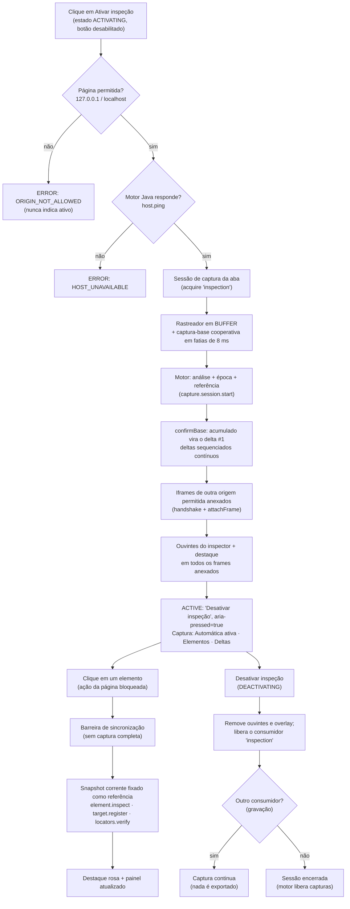

# Inspeção com botão único (CHROME-002)

## Botão e estados

O painel tem **um único botão** (`#btn-inspect`, `aria-pressed`, cor `#C2466D`), cujo texto e estado
vêm do service worker (`inspection.state` / evento `inspection-state`):

| Estado | Texto | `aria-pressed` | Clique |
|---|---|---|---|
| `INACTIVE` | Ativar inspeção | `false` | ativa |
| `ACTIVATING` | Ativando inspeção... | `false` | ignorado (botão desabilitado) |
| `ACTIVE` | Desativar inspeção | `true` | desativa |
| `DEACTIVATING` | Desativando inspeção... | `true` | ignorado |
| `DEGRADED` | Desativar inspeção (+ mensagem) | `true` | desativa |
| `ERROR` | Ativar inspeção (+ mensagem da falha) | `false` | tenta de novo |

- Transições serializadas por aba (exclusão mútua): cliques duplos e comandos concorrentes produzem
  **uma** ativação (C002-004).
- Uma falha nunca é exibida como ativa: origem não permitida, motor ausente ou falha da captura-base
  ⇒ `ERROR`, ouvintes e observadores removidos (C002-005).
- O estado é por aba e reconstruído ao fechar/reabrir o painel, trocar de aba, recarregar a página e
  reiniciar o service worker (C002-012/013/014/015/019).
- `DEGRADED`: inspeção ligada, captura sem motor ou em erro; volta a `ACTIVE` quando a sessão se recupera.

## Fluxo da nova inspeção

## Seleção sem recaptura

Com sessão ativa, `page.select`/clique executa a **barreira** e fixa a captura corrente
(`capture.pin`), usada por `element.inspect`, `target.register` e `locators.verify`. Dez seleções
seguidas sem mudanças ⇒ **uma** captura completa (a base) e dez reutilizações (C002-011). Sem
sessão (fluxo CHROME-001), a seleção continua fazendo captura avulsa.

## Indicador de estado

| Campo | Fonte | Atualização |
|---|---|---|
| Host Java | `host.ping` / `hostState` | evento |
| Captura | `session.status` | evento `session-status` (limitado a 1 a cada 250 ms) |
| Elementos | `nodes` do motor | idem |
| Última atualização | `lastUpdateAt` | relógio local a cada 1 s (sem mensagens) |
| Deltas | `deltasApplied` | idem |

Nenhum PageMap trafega para atualizar contadores; o painel altera somente os campos que mudaram.

## DEV × PRD

| | DEV | PRD |
|---|---|---|
| Quem define | `src/shared/build-mode.js` (`BUILD_MODE`), gerado por `scripts/build.ps1 -Mode PRD` → `dist/prd` | idem |
| Área DEV no painel | Testar reencontro · Comparar snapshots · Exportar mapa · Forçar captura completa | **removida do documento** (C002-048) |
| Comandos DEV no service worker | permitidos | recusados com `MODE_RESTRICTED` |
| Harness de testes | presente | ausente na construção PRD |
| Simular PRD | páginas internas da extensão podem simular (`config.setMode`) para homologação | troca recusada (`MODE_LOCKED`) |
| Exportação | manual (DEV) e na finalização da gravação | somente na finalização da gravação |

A página web **nunca** altera o modo. PRD não autoriza distribuição, produção nem inspeção de sites
reais: a política de origem é a mesma nos dois modos.

## Interação com a página durante a inspeção

Com a inspeção ativa, cliques são **seleções** (a ação da página não executa, requisito da
CHROME-001). A captura contínua acompanha mudanças provocadas pela própria página (temporizadores,
respostas de rede, gravação). Nos testes, as ações do cenário são acionadas chamando o manipulador
do botão (`onclick()`), e cliques reais são usados para seleção e após a desativação.
