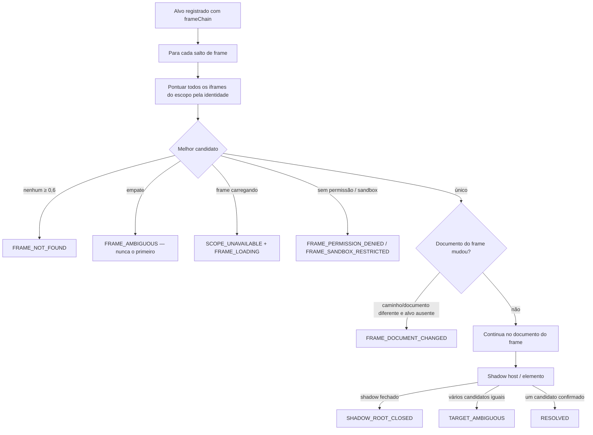

# Identidade de documentos e frames (CHROME-003 §5, §7, §19)

## Identificadores lógicos × identificadores do navegador

| Identificador | Exemplo | Origem | Uso |
|---|---|---|---|
| `frameId` lógico | `f0`, `f4`, `xn8`, `c32f1` | motor (snapshot) | referência dentro de uma captura; **não** é identidade estável |
| `documentId` lógico | `doc:f4` | motor | documento atual do frame lógico |
| `browser.browserFrameId` | `7` | Chrome (`webNavigation`) | só para comandos ao navegador |
| `browser.browserDocumentId` | `C14B6905…` | Chrome | distingue documentos ao longo de navegações; muda a cada recarga |
| `pageSessionId` | `ps-mv7j…` | content script | sessão do documento principal |

Os identificadores do Chrome **nunca** são inventados: sem associação comprovada, o campo fica `null` (§5.2). A
associação usa, nesta ordem: `TOP` (documento principal), `HANDSHAKE` (token aleatório publicado pelo frame e
reconhecido pelo dono da captura do pai, que devolve o nó `iframe`) e `URL_MATCH` (usado para about:blank/srcdoc).
`URL_MATCH` só associa quando **todas** as condições valem (D-052):

1. o documento pai tem identidade confirmada no Chrome (`TOP`, `HANDSHAKE` ou `URL_MATCH`) e `frameId` conhecido;
2. o candidato do Chrome declara `parentFrameId` igual ao do pai (e, quando ambos informados, `parentDocumentId` igual
   ao `documentId` do pai — um pai que navegou não serve);
3. a URL é única entre os candidatos do Chrome desse pai;
4. a URL é única entre os iframes lógicos elegíveis (sem handshake) do mesmo pai.

Qualquer condição falha ⇒ nenhuma associação: dois about:blank irmãos com um único registro temporário do Chrome
ficam ambos sem `browserDocumentId`. É preferível um documento não identificado a uma identidade incorreta.

## URL declarada × efetiva × origem (§5.3)

| Campo | Fonte | Observação |
|---|---|---|
| `declaredSrc` | atributo `src` do iframe, resolvido contra o pai | sanitizado (sem query/fragmento) |
| `effectiveUrl` | `location.href` do documento (ou do Chrome, se o conteúdo for inacessível) | difere do declarado após navegação interna (F003-003) |
| `origin` | origem efetiva; about:blank/srcdoc herdam a do pai; sandbox sem `allow-same-origin` ⇒ `"null"` (opaca) | |
| `documentKind` | `MAIN`, `NETWORK`, `ABOUT_BLANK`, `INITIAL_ABOUT_BLANK`, `SRCDOC`, `UNKNOWN` | |
| `queryKeys` | somente os **nomes** dos parâmetros | valores nunca exportados nas seções novas |

## Ciclo de vida do documento (§19)

`DocumentDescriptor.lifecycle`: `ACTIVE`, `LOADING`, `TEMPORARY` (about:blank), `INACCESSIBLE`. Documentos
substituídos/removidos deixam o grafo na captura seguinte; o histórico de transições está nas mutações da sessão
(`MutationEvent`) e nos motivos de recaptura. Documentos inacessíveis nunca têm conteúdo inventariado.

## Identidade de frame (§7)

`FrameIdentity` combina: `id`, `name`, `title`, atributos estáveis, **contêiner** (região/seção/título que contém o
iframe), **cadeia de pais**, caminho da URL (sem query) e origem. Não usa índice, posição, ordem nem `frameId`
(§7.2). O reencontro compara a identidade registrada com **todos** os iframes do escopo e aceita somente
pontuação ≥ 0,6 sem empate:

Frames irmãos equivalentes (mesmos atributos, contêiner e URL) são marcados `identityAmbiguous` no grafo e qualquer
alvo dentro deles é declarado ambíguo (F003-009). Os diagnósticos de frame **complementam** os status existentes
(`RESOLVED`, `AMBIGUOUS`, `STALE_TARGET`, `SCOPE_UNAVAILABLE`…), sem substituí-los (§23).

## Estabilidade (§23)

`HEURISTIC_STABLE` / `OBSERVED_STABLE` / `UNSTABLE` / `UNKNOWN` para localizadores de iframes e para a trajetória
(pior estabilidade entre os passos). Observação em várias capturas promove a estabilidade (regra da CHROME-001).
