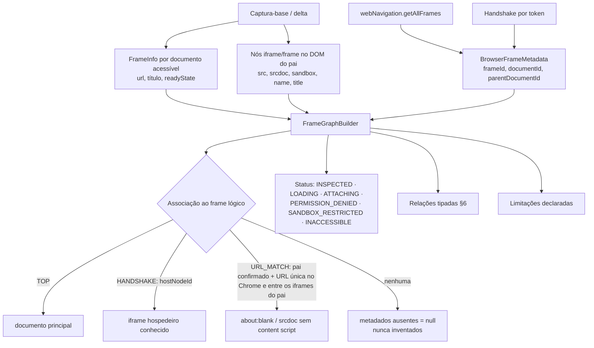

# Frame Intelligence (CHROME-003)

A Frame Intelligence transforma a captura contínua da CHROME-002 em um **grafo documental**: documentos, iframes,
shadow roots e as relações entre eles. Ela não substitui a captura: reutiliza o snapshot mantido pelos deltas e
acrescenta os metadados que o próprio Chrome fornece sobre os frames.

## Componentes

| Camada | Componente | Responsabilidade |
|---|---|---|
| Content script | `capture.js` | inventário de frames acessíveis (`FrameInfo`: URL, título, `readyState`), shadow roots e recursos observáveis |
| Content script | `mutation-tracker.js` | observação contínua; detecta **troca de documento** de iframes de mesma origem (navegação interna, carregamento tardio, recarga) e recaptura só aquele iframe |
| Content script | `content-main.js` | handshake de frames (`postMessage` com token aleatório a todos os ancestrais) |
| Service worker | `frames.js` | anexa frames de outra origem permitida (content script no próprio frame); resolve o handshake no frame **dono da captura** |
| Service worker | `diagnostics.js` | `webNavigation.getAllFrames` → metadados do Chrome (`frameId`, `documentId`, `parentDocumentId`, ciclo de vida) enviados ao motor; comandos de consulta |
| Motor Java | `FrameGraphBuilder` | `FrameGraph` (documentos, frames, relações, contagens, limitações) |
| Motor Java | `FrameIdentities` | identidade de frame (atributos, contêiner, cadeia de pais, caminho e origem) |
| Motor Java | `AccessPathBuilder` | `ElementAccessPath` (documento → iframes → shadow roots → elemento) e explicação |
| Motor Java | `TargetResolver` | reencontro com salto de frame resolvido pela **identidade**, nunca por índice |

As regras ficam no Java (§33). O JavaScript coleta dados do navegador e orquestra; não há regra duplicada.

## Fluxo de construção do grafo

## Relações (§6)

| Relação | De → Para |
|---|---|
| `DOCUMENT_CONTAINS_FRAME` | documento pai → frame |
| `FRAME_HAS_DOCUMENT` | frame → documento atual |
| `FRAME_PARENT_OF` / `FRAME_CHILD_OF` | frame pai ↔ frame filho |
| `FRAME_HOSTED_BY_ELEMENT` | frame → nó `iframe` hospedeiro |
| `ELEMENT_BELONGS_TO_DOCUMENT` / `ELEMENT_BELONGS_TO_FRAME` | elementos **estruturais** (hosts de iframe e de shadow root) → documento/frame |
| `SHADOW_ROOT_BELONGS_TO_DOCUMENT` | shadow root → documento |

A pertença de **cada** elemento comum é dada por `elements[].documentId` no PageMap; emitir uma relação por nó
(dezenas de milhares) não acrescentaria informação e custaria memória (decisão D-040).

## Cenários do laboratório (§8)

| Cenário | Página | Comportamento verificado |
|---|---|---|
| A — documento → iframe → elemento | `chrome003/frames.html` (Contas) | trajetória com 1 iframe; localizador do elemento executado no documento do iframe (F003-004) |
| B — dois níveis | Financeiro → Contas a pagar | não confunde com o Salvar do cenário A (mesma URL) (F003-005) |
| C — dois níveis + Shadow DOM | Financeiro → Pagamentos → `nk-pagamento` | explicação legível, destaque do iframe imediato (F003-006) |
| D — Shadow DOM contendo iframe | `nk-suporte` → Widget de suporte | ordem `SHADOW_ROOT → IFRAME` (F003-007) |
| E — irmãos idênticos | Filial Norte × Filial Sul | reencontro no frame correto, inclusive após recarga do documento do frame (F003-008) |
| F — mesmo name/URL | Vendas × Compras | distinguidos pelo contêiner; contêineres iguais ⇒ `FRAME_AMBIGUOUS`, nunca o primeiro (F003-009) |
| G — iframe removido | `frames-dynamic.html` (Pedidos) | `FRAME_NOT_FOUND`; o Salvar de outro frame com a mesma URL não é aceito (F003-010) |
| H — iframe recriado (SPA) | Cadastro | invalidado, identificado, validado e reconstruído; sem recaptura completa (F003-011) |
| I — about:blank | Rascunho | origem herdada, conteúdo capturado pelo pai, metadados do Chrome por `URL_MATCH` (F003-012) |
| srcdoc | Resumo | `SRCDOC`, um único inventário (F003-013) |
| J — sem permissão | `frames-origins.html` (127.0.0.2) | `PERMISSION_DENIED`, conteúdo nunca inventariado, sem content script (F003-014, N003-H) |
| Sandbox | Conteúdo isolado | origem opaca `null`, `SANDBOX_RESTRICTED`; com `allow-same-origin`, inspecionado (F003-015) |
| Outra origem permitida aninhada | Relatórios (porta +1) → Gráficos → shadow | trajetória entre origens (F003-016) |
| Carregamento lento | `/generated/slow-frame` | `LOADING` com confiança reduzida; depois `INSPECTED` (F003-017) |

## APIs do Chrome investigadas (§8)

| API / opção | Uso | Decisão |
|---|---|---|
| `webNavigation.getAllFrames` | `frameId`, `parentFrameId`, `documentId`, `parentDocumentId`, `documentLifecycle`, `frameType` (Chrome ≥ 106) | **usado** (permissão `webNavigation` já existente) |
| `webNavigation.onCommitted/onCompleted/onErrorOccurred` | navegações de subframes | **usado**, com espera de 250 ms (rajadas) |
| `all_frames: true` | content script em frames de origens permitidas | **mantido** (CHROME-002) |
| `match_about_blank` / `match_origin_as_fallback` | content script em about:blank/srcdoc/blob | **não habilitado**: esses documentos já são capturados pelo pai via `contentDocument`; injetar ali criaria uma segunda fonte para o mesmo documento (duplicidade, §8). Os metadados do Chrome são associados por URL única sob o mesmo pai confirmado (D-052) |
| `scripting.executeScript({allFrames})` | injeção sob demanda | **não usado**: a injeção declarativa já cobre as origens permitidas; injeção imperativa não amplia o que é permitido |
| `frameId` como identidade | — | **nunca**: é válido só no navegador e muda a cada recriação; a identidade lógica é independente (§7.2) |

A permissão para a página principal **não** é presumida para os frames: um frame de origem não listada em
`host_permissions` fica `PERMISSION_DENIED` (verificado: nenhum content script responde nele — N003-H).

## Observação contínua (§22)

| Evento | Detecção | Ação |
|---|---|---|
| iframe inserido/removido | `MutationObserver` do documento/shadow root | delta com o subtree; frame entra/sai do grafo |
| `src` alterado | mutação de atributo | recaptura do iframe |
| navegação interna (mesmo iframe, novo documento) | `load` na fase de captura + verificação periódica do `contentDocument` (1 s) | recaptura **só do iframe** (`frameDocumentsReplaced`) |
| frame de outra origem navegou | `webNavigation` + content script do frame (`frame-ready`) | novo anexo com o novo `documentId` |
| host recriado (SPA) | remoção + inserção | identidade revalidada; alvo reencontrado |
| shadow root tardio | reconciliação periódica (CHROME-002) | delta |

Nenhum desses casos dispara recaptura completa (F003-018 e D003-001 verificam `fullCaptures` inalterado). Quando uma
recaptura completa acontece, o motivo fica em `session.lastCapture.reason` (`RESYNC:<motivo>`, `NAVIGATION`, …).
