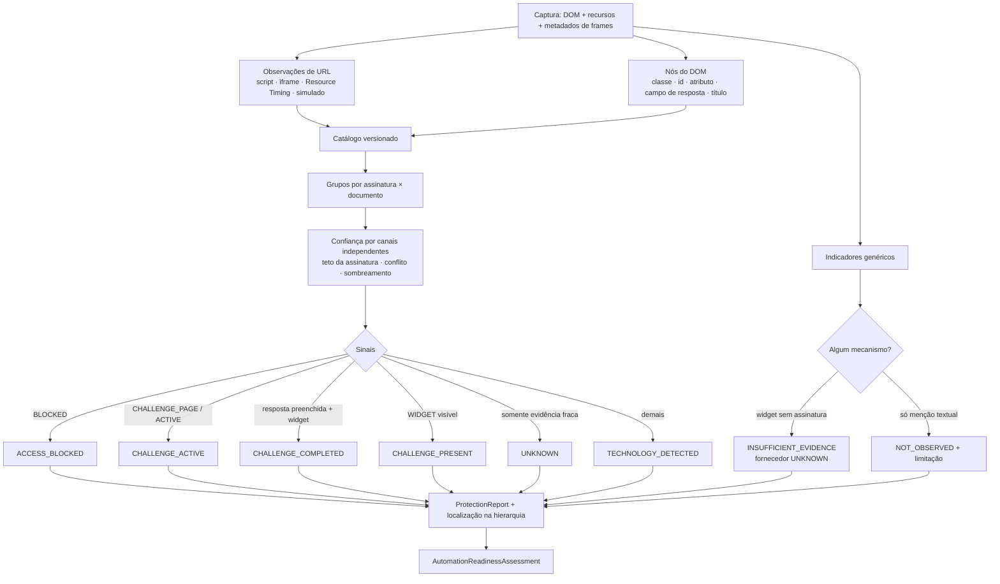

# Protection Diagnostics (CHROME-003 §11–§18)

O **Protection Detection Engine** identifica, de forma **passiva, determinística e explicável**, evidências
observáveis de CAPTCHA, desafios, WAF e gerenciamento de bots. **O objetivo não é contornar essas proteções**: o
resultado serve para planejar automação autorizada (intervenção humana, API autorizada, configuração de ambiente).

## Política passiva (§12)

| Faz | Não faz |
|---|---|
| lê o que a captura já tem: DOM, atributos, scripts/folhas referenciados, Resource Timing (URLs), metadados de frames | executar desafios, resolver CAPTCHA, chamar funções da página (isca `window.grecaptcha` comprovadamente não chamada — P003-013) |
| registra presença de `data-sitekey` como `[redacted]` | coletar chaves, tokens, cookies, cabeçalhos `Authorization`, corpos, valores de campos de resposta |
| mantém **nomes** de parâmetros de URL | exportar **valores** de parâmetros (`src` de iframe/script: `k=REDACTED`) |
| declara limites e `UNKNOWN`/`INSUFFICIENT_EVIDENCE` | afirmar que a página **não** tem proteção (`NOT_OBSERVED` ≠ ausência) |
| usa o catálogo versionado | gerar tráfego, interceptar/modificar requisições, alterar fingerprint ou ocultar automação |

Nenhuma permissão nova foi adicionada: Resource Timing e DOM já estão acessíveis ao content script nas origens
permitidas; `webNavigation` já existia.

## Catálogo versionado (§16)

`contracts/protection-signatures.json` (`catalogVersion 2026.10.1`, revisado em 2026-10-14), validado por
`contracts/protection-catalog.schema.json` e por `SignatureCatalog.validate()` (assinatura de observação de
terceiros não pode ter teto `HIGH`). Extensível: novas assinaturas são dados, não código.

| Assinatura | Fornecedor / produto | Categoria | Base | Teto | Fonte principal |
|---|---|---|---|---|---|
| `google.recaptcha.v2` | Google reCAPTCHA v2 | CAPTCHA | documentação oficial | HIGH | developers.google.com/recaptcha/docs/display |
| `google.recaptcha.v3` | Google reCAPTCHA v3 | avaliação de risco | documentação oficial | MEDIUM | developers.google.com/recaptcha/docs/v3 |
| `hcaptcha` | hCaptcha | CAPTCHA | documentação oficial | HIGH | docs.hcaptcha.com |
| `cloudflare.turnstile` | Cloudflare Turnstile | verificação humana | documentação oficial | HIGH | developers.cloudflare.com/turnstile |
| `cloudflare.challenge-page` | Cloudflare Challenge Page | página de desafio | observação de terceiros | MEDIUM | developers.cloudflare.com/cloudflare-challenges (tipos); estrutura não especificada |
| `cloudflare.bot-management` | Cloudflare Bot Management (JS detections) | bot management | observação de terceiros | MEDIUM | fontes secundárias (`/cdn-cgi/challenge-platform/scripts/jsd/`) |
| `cloudflare.block-page` | Cloudflare (página de bloqueio) | bloqueio | observação de terceiros | MEDIUM | estrutura pública das páginas de erro |
| `aws.waf.captcha` | AWS WAF CAPTCHA / Challenge | desafio | documentação oficial | HIGH | docs.aws.amazon.com/waf (JS CAPTCHA API) |
| `akamai.bot-manager` | Akamai Bot Manager | bot management | observação de terceiros | LOW | observações públicas, não confirmadas |
| `datadome` | DataDome | bot management | documentação oficial | HIGH | docs.datadome.co/docs/javascript-tag |
| `human.perimeterx` | HUMAN (PerimeterX) Bot Defender | bot management | observação de terceiros | MEDIUM | docs.humansecurity.com (primeira parte) + fontes secundárias |
| `imperva.incapsula` | Imperva (Incapsula) | WAF | observação de terceiros | LOW | observações públicas, não confirmadas |

Os indicadores de cada fornecedor foram conferidos com a documentação atual em 2026-10-14 (§11: "não presumir que
uma assinatura antiga continue válida"); onde não há documentação do fornecedor, a assinatura é marcada
`THIRD_PARTY_OBSERVATION` e tem teto reduzido. Indicadores genéricos (texto "captcha", "não sou um robô",
`data-sitekey`) **nunca** identificam fornecedor.

## Estados (§13, §18)

| Estado | Significado | Evidência exigida |
|---|---|---|
| `TECHNOLOGY_DETECTED` | tecnologia presente | script/recurso/elemento da assinatura |
| `CHALLENGE_PRESENT` | widget de desafio visível | sinal `WIDGET` visível |
| `CHALLENGE_ACTIVE` | desafio em curso / página de desafio | sinal `CHALLENGE_ACTIVE`/`CHALLENGE_PAGE` |
| `CHALLENGE_COMPLETED` | conclusão **explícita** | campo de resposta **preenchido** com widget visível (valor não coletado) |
| `ACCESS_BLOCKED` | página de bloqueio | sinal `BLOCKED` |
| `UNKNOWN` | evidência insuficiente para afirmar estado | ex.: somente evidência fraca (LAB-P10) |
| `NOT_OBSERVED` (relatório) | nenhuma assinatura observada | **não** significa ausência de proteção |

Tecnologia ≠ desafio ≠ bloqueio (P003-012). O desaparecimento visual de um widget **nunca** é interpretado como
conclusão (P003-010).

## Localização na hierarquia (§14)

`location`: `documentId`, `frameId`, `insideFrame`, `frameChain` (títulos), `inspectable`, `widgetNodeId` e
`accessPath` até o widget. Widget em iframe sem inspeção de conteúdo (ex.: o iframe real do fornecedor) ⇒ somente a
URL do iframe é avaliada e o estado interno é declarado desconhecido.

## Laboratório (§17)

Fixtures em `test-lab/pages/chrome003/protection/`, todas **simuladas**: scripts com
`type="application/x-nekkora-inert"` (o navegador não busca nem executa), URLs de widgets em
`data-nekkora-simulated-src` (o `src` real aponta para `simulated-widget.html` local) e chaves `LAB-FICTICIA-*`.
Evidências produzidas por metadados de simulação são marcadas `simulated: true` e geram a limitação
"referência inerte, sem tráfego real" — assinaturas observáveis e metadados fictícios ficam distinguidos.

| Fixture | Conteúdo | Resultado esperado (verificado) |
|---|---|---|
| LAB-P01 | reCAPTCHA v2 (script, widget, iframe âncora, campo de resposta) | GOOGLE/RECAPTCHA_V2 · HIGH · CHALLENGE_PRESENT; preenchido ⇒ CHALLENGE_COMPLETED |
| LAB-P02 | hCaptcha (+ desafio `#frame=challenge` sob demanda) | HIGH · CHALLENGE_PRESENT → CHALLENGE_ACTIVE |
| LAB-P03 | Turnstile | HIGH · CHALLENGE_PRESENT |
| LAB-P04 | página de desafio ("Just a moment…", `/cdn-cgi/challenge-platform/h/`, `#challenge-form`) | MEDIUM (teto) · CHALLENGE_ACTIVE · intervenção humana |
| LAB-P05 | widget próprio + "Confirme que você é humano" | INSUFFICIENT_EVIDENCE · fornecedor UNKNOWN |
| LAB-P06 | artigo sobre CAPTCHA (falso positivo) | NOT_OBSERVED + limitação de menção textual |
| LAB-P07 | reCAPTCHA v3 (`render=`), DataDome, `/akam/` | v3 MEDIUM; v2 LOW/POSSIBLE (referência compartilhada); DataDome MEDIUM; Akamai LOW |
| LAB-P08 | Turnstile em Pagamento → Confirmação | localização com `frameChain` e trajetória |
| LAB-P09 | widget inserido e removido | observado por delta; remoção ⇒ NOT_OBSERVED (nunca COMPLETED) |
| LAB-P10 | `#captcha-container` + iframe sem permissão | AWS WAF POSSIBLE · LOW · UNKNOWN; validação manual |
| LAB-P11 | página de bloqueio | ACCESS_BLOCKED |

## Recomendações (§15)

`HUMAN_INTERVENTION`, `AUTHORIZED_API`, `ENVIRONMENT_CONFIGURATION`, `MANUAL_VALIDATION`, `UNKNOWN_PROTECTION`,
`NO_ACTION_REQUIRED`. Nenhuma recomendação sugere contornar CAPTCHA, disfarçar automação, falsificar sinais do
navegador ou desabilitar proteções de terceiros (verificado por expressão regular em todas as fixtures — P003-014).
