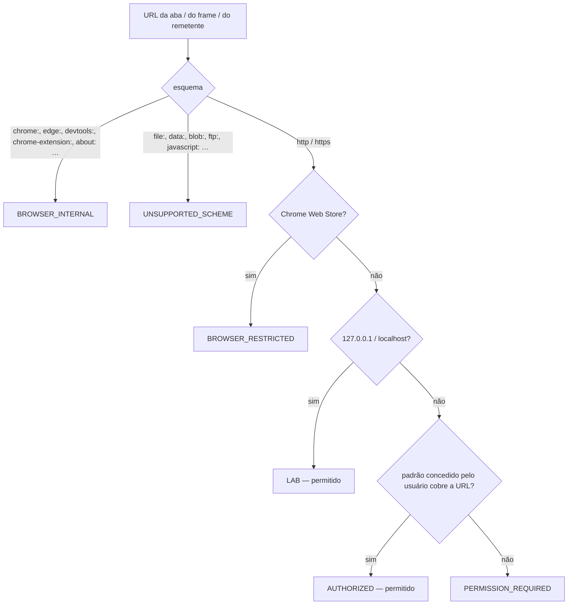
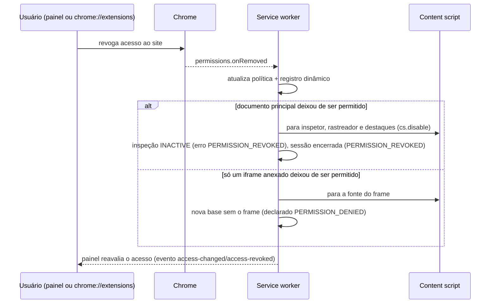

# Acesso a sites externos (NEKKORA-REAL-001)

A extensão passou a interpretar páginas http/https **autorizadas pelo usuário**, além do laboratório local. A
autorização é sempre explícita, por site ou ampla, e pode ser revogada a qualquer momento — pelo painel ou pelo
controle "Acesso ao site" do próprio Chrome.

## Permissões do manifesto

| Campo | Valor | Motivo |
|---|---|---|
| `host_permissions` | `http://127.0.0.1/*`, `http://localhost/*` | laboratório local (inalterado) |
| `optional_host_permissions` | `https://*/*`, `http://*/*` | **teto** do que o usuário pode conceder; nada é concedido na instalação |
| `permissions` | `nativeMessaging`, `sidePanel`, `storage`, `scripting`, `webNavigation`, `alarms` | **inalterado** — nenhuma permissão nova |

Não são solicitadas permissões de cookies, histórico (`history`, `tabs`), credenciais, `webRequest`,
`declarativeNetRequest` nem `debugger`. Sem a permissão `tabs`, o Chrome não informa a URL de abas sem acesso; a
extensão usa o metadado do frame principal (`webNavigation`, já existente) **apenas** para decidir e explicar, e
devolve ao painel somente a origem e o padrão a solicitar.

## Política central (`background/access-policy.js`)

Todas as decisões de origem passam por um único módulo (antes havia seis verificações de `localhost` espalhadas em
`runtime.js`, `inspection.js`, `capture-session.js`, `frames.js`, `diagnostics.js`, `service-worker.js` e no
content script).

Recusa ⇒ erro `ORIGIN_NOT_ALLOWED` (código mantido desde a CHROME-001) com `reason` detalhado e mensagem em
português. O espelho das permissões ativas é atualizado em `permissions.onAdded/onRemoved`; a decisão é síncrona e
nunca presume permissão: a injeção continua sujeita às permissões reais do Chrome.

## Injeção dos content scripts (`background/injection.js`)

- **Laboratório**: `content_scripts` estáticos do manifesto (inalterado).
- **Origens autorizadas**: um registro dinâmico (`chrome.scripting.registerContentScripts`, id
  `nekkora-authorized-origins`) com os **mesmos arquivos na mesma ordem**, `allFrames`, `document_idle`,
  `persistAcrossSessions`; sincronizado a cada concessão/revogação. O laboratório é excluído (`excludeMatches`)
  para que uma autorização ampla nunca injete duas vezes.
- **Abas já abertas antes da autorização**: na ativação, a extensão verifica frame a frame quais documentos já
  executam o content script e injeta (`executeScript` com a lista do manifesto) **somente** nos que faltam e cuja
  origem é permitida. Cada arquivo também tem guarda contra reexecução.
- **Navegar não captura**: o content script presente fica ocioso (sem observadores, sem ouvintes) até um
  consumidor ativar a sessão (botão "Ativar inspeção", gravação ou consumidor autorizado do contrato).

## Painel — "Acesso ao site"

| Estado | Ações |
|---|---|
| Laboratório local | — |
| Não autorizado (`PERMISSION_REQUIRED`) | **Autorizar este site** (pede `scheme://host/*` no diálogo do Chrome); **Autorizar todos os sites…** (exige uma segunda confirmação explícita no painel e depois o diálogo do Chrome) |
| Autorizado (este site / autorização ampla) | **Revogar acesso a este site** / **Revogar autorização ampla** |
| Página interna, esquema não suportado, loja do Chrome | somente a explicação; nada a autorizar |

A concessão acontece **sempre** no clique do usuário (gesto exigido pelo Chrome) e pelo diálogo do Chrome; nada é
concedido automaticamente, nem mesmo para o domínio de um iframe encontrado na página.

## Revogação

Navegar para uma origem não autorizada durante a sessão encerra a sessão (`ORIGIN_NOT_ALLOWED`), pois nenhum
content script existirá ali para avisar.

## Iframes de outra origem

A permissão da página principal **não** se estende às origens dos seus frames: iframe de origem autorizada é
anexado pelo próprio content script (como na CHROME-002/003); de origem sem autorização fica `PERMISSION_DENIED`
(metadado do Chrome `NO_PERMISSION`), sem inventário, sem associação presumida e sem pedido automático de permissão
(R001-03, R001-04).

## Homologação automatizada sem automatizar diálogos

O diálogo de permissão é interface do navegador e **não** é clicado por automação. A construção de teste
(`integration-tests/target/test-extension`) é a extensão publicada com as origens de teste em `host_permissions`
(concessão na instalação); a revogação e a reconcessão usam o controle "Acesso ao site" do Chrome
(`chrome.developerPrivate.removeHostPermission/addHostPermission`, a mesma API da página `chrome://extensions`), que
dispara os mesmos eventos `permissions.onRemoved/onAdded` da revogação pelo usuário. Os hosts "externos" de teste
(`site-a/site-b/site-x.nekkora.test`) são resolvidos para 127.0.0.1 pelo próprio Chrome (`--host-resolver-rules`).
A verificação do diálogo real ("Autorizar este site" no painel) é **manual** (ver relatório final).
