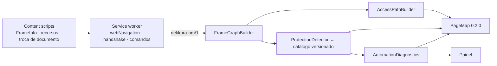

# NEKKORA-CHROME-003 — Relatório final

**Frame Intelligence, Protection Diagnostics & Final Consolidation** · branch `feat/nekkora-chrome-003` · 2026-10-14

## 1. Resumo

A extensão passou a entender a **hierarquia documental** da página (documentos, iframes, shadow roots e relações),
a descrever a **trajetória de acesso** de cada elemento através de múltiplos iframes e shadow roots, a reencontrar
alvos por uma **identidade de frame** que não depende de índice, ordem ou `frameId`, e a produzir dois diagnósticos
**passivos**: tecnologias de proteção (CAPTCHA, desafios, WAF, gerenciamento de bots) e prontidão para automação.
Tudo foi integrado ao PageMap (**0.2.0**) e ao painel (Documentos/Iframes/Shadow Roots, TRAJETÓRIA, DIAGNÓSTICO).

Resultado da homologação final no Chrome for Testing 155: **174/174 casos aprovados** (117 da linha de base
CHROME-002 + 57 novos da CHROME-003), além de 168 + 27 + 4 testes unitários Java, 2 de contrato e 12 da extensão
(números após a correção do P1 da revisão do PR #2 — seção 17).

Nada foi contornado: nenhuma proteção é burlada, nenhum desafio é executado, nenhuma função da página é chamada e
nenhum serviço real de fornecedor foi contatado — todas as fixtures de proteção são simuladas com referências inertes.
**A extensão não compreende qualquer iframe nem detecta qualquer proteção antibot**; os limites estão na seção 14.

## 2. Linha de base

Commit `531b63d` arquiva a execução da CHROME-002 na `main` (47d7a16): **117/117** casos no navegador
(`reports/chrome-003/baseline/test-matrix-integration.md`) e o desempenho de 100 a 20.000 elementos
(`reports/chrome-003/baseline/performance.md`). Todos os 117 casos continuam na suíte e aprovados; nenhum teste foi
removido ou afrouxado. As únicas asserções alteradas são as de versão do PageMap (`0.1.0` → `0.2.0`), acompanhando a
mudança intencional de contrato (D-037).

## 3. Arquitetura

Motor Java 21 continua como núcleo (§3, §33). Novos pacotes sem dependências de runtime: `core/frames`,
`core/protection`, `core/diagnostics`; no host, `FrameCommands` e `CatalogLoader`; na extensão, `background/diagnostics.js`
e extensões pontuais da captura, do rastreador, do handshake e do painel. Diagramas em
[docs/architecture.md](../docs/architecture.md#chrome-003--frame-intelligence-e-diagnóstico) e no
[README](../README.md#frame-intelligence-e-diagnóstico-de-proteções-chrome-003).



## 4. Funcionalidades entregues

| Área | Entrega | Evidência |
|---|---|---|
| Frame Intelligence | grafo com 8 tipos de relação, status de inspeção, `documentKind`, origem efetiva/opaca, limitações | F003-001, F003-012..017 |
| Document Identity | ids lógicos × `frameId`/`documentId` do Chrome (TOP/HANDSHAKE/URL_MATCH, nunca inventados); URL declarada × efetiva × origem | F003-002/003 |
| Element Access Path | passos com localizador no escopo, condição esperada, restrição, estabilidade e explicação legível | F003-004..007, F003-016 |
| Reencontro entre frames | salto de frame por identidade (≥ 0,6, empate ⇒ ambiguidade), diagnósticos `FRAME_*`, `SHADOW_ROOT_CLOSED`, `TARGET_AMBIGUOUS` | F003-008..011, N003-F |
| Observação contínua | inserção, remoção, troca de `src`, navegação interna, iframe recriado, frame lento — sem recaptura completa | F003-017/018, D003-001 |
| Protection Detection | 12 assinaturas (11 fornecedores/produtos + página de bloqueio), indicadores genéricos, estados, localização, recomendações | P003-001..015 |
| Automation Diagnostics | 22 tipos de obstáculo, dependências de interação, status sem pontuação artificial, confiança por cobertura | P003, I003-01..10 |
| PageMap 0.2.0 | `frameGraph`, `accessPaths`, `protection`, `readiness`, `elements[].documentId` | F003-020 |
| Painel | contadores, TRAJETÓRIA, DIAGNÓSTICO, Destacar iframe e Diagnosticar página (DEV) | F003-019 |
| Laboratório | `chrome003/` (cenários A–J), `protection/` (LAB-P01..P11), `/generated/frames`, `/generated/slow-frame` | todas as matrizes |

## 5. Frame Intelligence

Exemplo real (página de hierarquias): 10 documentos, 9 iframes, profundidade 2, 3 shadow roots (1 fechado), todos os
documentos acessíveis associados ao `documentId` do Chrome; o iframe recriado por SPA é invalidado e reconstruído
sem recaptura (F003-011); o iframe removido produz `FRAME_NOT_FOUND` e o botão homônimo de outro frame com a mesma URL
**não** é aceito (F003-010); contêineres idênticos produzem `FRAME_AMBIGUOUS` e nenhum candidato é escolhido
(F003-009). Detalhes: [frame-intelligence.md](../docs/chrome-003/frame-intelligence.md).

Correções feitas durante a homologação (cada uma com teste):

1. handshake de frames aninhados de mesma origem era resolvido no frame errado — iframes de 2º nível ficavam sem
   `documentId` do Chrome (D-039);
2. navegação interna/carregamento tardio de iframe de mesma origem não era observado (D-042);
3. about:blank/srcdoc sem content script nunca recebiam metadados do Chrome — associação por URL única sob o mesmo
   pai, nunca por adivinhação (D-038, D-041);
4. o limite de 20 frames anexados contava frames que só fazem handshake (D-043);
5. (revisão do PR #2, P1) `URL_MATCH` aceitava candidato do Chrome sem pai confirmado e o único registro do Chrome
   quando havia dois irmãos about:blank equivalentes — passou a exigir pai confirmado e unicidade no Chrome e entre os
   iframes lógicos do mesmo pai (D-052).

## 6. Document Graph

`FrameGraph` + `DocumentDescriptor` (ciclo de vida `ACTIVE`/`LOADING`/`TEMPORARY`/`INACCESSIBLE`, `queryKeys`
somente com nomes). `ELEMENT_BELONGS_TO_*` para elementos estruturais; pertença dos demais em `elements[].documentId`
(D-040). Detalhes: [document-identity.md](../docs/chrome-003/document-identity.md).

## 7. Element Access Path

Cenário C (F003-006): `MAIN_DOCUMENT → IFRAME «Financeiro» → IFRAME «Pagamentos» → SHADOW_ROOT nk-pagamento →
ELEMENT «Confirmar pagamento»`, com explicação: *"O elemento button «Confirmar pagamento» foi encontrado no formulário
«Pagamento», no 2º nível de iframe da página e dentro de 1 shadow root. …"*. Nenhum localizador atravessa documentos
(§20). Detalhes: [element-access-path.md](../docs/chrome-003/element-access-path.md).

## 8. Diagnóstico antibot

Passivo (§12): lê DOM, scripts/folhas referenciados e Resource Timing já disponíveis; não executa desafios, não
resolve CAPTCHA, não gera tráfego, não altera fingerprint, não oculta automação, não coleta cookies/tokens/cabeçalhos/
valores. `data-sitekey` e valores de parâmetros de URL de iframes/scripts são redigidos. Confiança por canais
independentes com teto por assinatura, conflito, sombreamento e regra de evidência fraca
([confidence-model.md](../docs/chrome-003/confidence-model.md)). Estados distinguem tecnologia, desafio presente,
desafio ativo, concluído (somente com campo de resposta preenchido), bloqueio e desconhecido; o desaparecimento de um
widget nunca é conclusão (P003-010). Recomendações nunca sugerem evasão (P003-014).

## 9. Tecnologias suportadas (catálogo 2026.10.1, revisado em 2026-10-14)

| Fornecedor / produto | Base | Teto |
|---|---|---|
| Google reCAPTCHA v2 | documentação oficial | HIGH |
| Google reCAPTCHA v3 | documentação oficial | MEDIUM |
| hCaptcha | documentação oficial | HIGH |
| Cloudflare Turnstile | documentação oficial | HIGH |
| Cloudflare Challenge Page | observação de terceiros | MEDIUM |
| Cloudflare Bot Management (JS detections) | observação de terceiros | MEDIUM |
| Cloudflare página de bloqueio | observação de terceiros | MEDIUM |
| AWS WAF CAPTCHA/Challenge | documentação oficial | HIGH |
| Akamai Bot Manager | observação de terceiros | LOW |
| DataDome | documentação oficial | HIGH |
| HUMAN (PerimeterX) | observação de terceiros | MEDIUM |
| Imperva (Incapsula) | observação de terceiros | LOW |

Os indicadores foram conferidos com a documentação atual de cada fornecedor; onde o fornecedor não documenta a
estrutura observável, a assinatura é rotulada como observação de terceiros e não pode chegar a `HIGH`
([protection-diagnostics.md](../docs/chrome-003/protection-diagnostics.md)).

## 10. Evidências

`reports/evidence/` (geradas pela execução final):

* `F003-001-frame-graph.json`, `F003-002-browser-metadata.json`, `F003-003-declared-vs-effective.json`,
  `F003-004/006-access-path.json`, `F003-008-siblings.json`, `F003-009-ambiguous-frames.json`,
  `F003-010-removed-frame.json`, `F003-011-spa-replaced-frame.json`, `F003-014-no-permission.json`,
  `F003-016-cross-origin-path.json`, `F003-017-loading.json`, `F003-018-continuous.json`, `F003-020-pagemap-sections.json`;
* capturas de tela: `F003-006-frame-highlight.png`, `F003-016-cross-origin-frame-highlight.png`,
  `F003-019-panel.png`, `F003-019-page-frame-highlight.png`;
* proteções: `P003-p01…p11-*-diagnosis.json`, `P003-003-hcaptcha-active.json`, `P003-010-dynamic-after-removal.json`,
  `P003-012-technology-challenge-block.json`, `P003-013-pagemap-protection.json`, `P003-014-recommendations.json`;
* negativos e integrados: `N003-F-frame-document-changed.json`, `I003-01…10-integrated.json` (cada um com captura,
  hierarquia, identificação, família, localizadores, trajetória, reencontro, diagnóstico e limitações).

## 11. Testes

| Suíte | Resultado |
|---|---|
| F003-001..020 — Frame Intelligence | 20/20 |
| P003-001..015 — Protection Diagnostics | 15/15 |
| N003-A..J — negativos | 10/10 |
| I003-01..10 — cenários integrados | 10/10 |
| D003-001..002 — desempenho | 2/2 |
| Unitários Java (core / host / laboratório) | 168 / 27 / 4 |
| Contrato (PageMap) | 2/2 |
| Extensão (Node) | 12/12 |

Matriz completa gerada pela execução: [test-matrix-integration.md](test-matrix-integration.md).

## 12. Regressão

Os 117 casos da CHROME-002/001 (T001–T040, C002-001..050, revisões C002-R*, negativos, comunicação, contrato,
Chrome convencional) foram executados na mesma rodada final: todos aprovados. Execução completa: 9 min 40 s (Chrome for Testing 155.0.8059.39, Java 21.0.12, Windows 11).

## 13. Desempenho

Fonte: [chrome-003/performance.md](chrome-003/performance.md) (medido pela suíte; ida e volta pelo WebDriver).

| iframes | depth | frames | nodes | discoveryEndToEndMs | captureMs | graphMs | protectionMs | readinessMs | diagnoseEndToEndMs | accessPathEndToEndMs | resolveMs | navigationUpdateMs | observers | hostHeapUsedMb | pageHeapUsedMb | exportMs | exportBytes |
|---|---|---|---|---|---|---|---|---|---|---|---|---|---|---|---|---|---|
| 1 | 1 | 1 | 14 | 45.43 | 4.5 | 0.12 | 0.17 | 0.1 | 9.56 | 10.85 | 21.64 | 62.36 | 2 | 11.3 | 2.7 | 8.33 | 109322 |
| 5 | 1 | 5 | 50 | 60.22 | 7.5 | 0.21 | 0.32 | 0.12 | 9.45 | 8.35 | 21.5 | 59.81 | 6 | 11.5 | 4.8 | 7.55 | 310632 |
| 10 | 1 | 10 | 95 | 84.42 | 10.0 | 0.44 | 0.51 | 0.16 | 11.65 | 9.73 | 23.38 | 54.31 | 11 | 11.6 | 8.1 | 11.26 | 563068 |
| 25 | 1 | 25 | 230 | 101.91 | 17.0 | 1.61 | 1.35 | 0.55 | 16.42 | 15.74 | 35.81 | 91.4 | 26 | 12.0 | 15.5 | 21.67 | 1324027 |
| 5 | 3 | 15 | 90 | 84.83 | 10.3 | 0.51 | 1.06 | 0.34 | 11.41 | 11.0 | 30.89 | 62.53 | 14 | 11.6 | 10.1 | 8.9 | 455417 |
| 3 | 5 | 15 | 80 | 80.3 | 11.9 | 0.53 | 1.24 | 0.27 | 13.69 | 12.87 | 26.6 | 61.37 | 12 | 11.6 | 10.3 | 9.47 | 375910 |
| 10 | 3 | 30 | 175 | 103.77 | 17.7 | 1.5 | 0.9 | 0.52 | 16.42 | 12.31 | 29.19 | 70.82 | 29 | 11.9 | 18.2 | 18.37 | 869463 |

Comparação com o baseline da CHROME-002 pelo **mesmo procedimento** do C002-038 (agora / baseline):

| Elementos | Nós | Captura síncrona (ms) | Export anterior (ms) | Bytes export anterior | Ciclo sessão (ms) | Captura cooperativa (ms) | Motor na base (ms) | Seleção (ms) | Export em fluxo (ms) | Bytes export em fluxo | Diagnóstico ida e volta (ms) |
|---|---|---|---|---|---|---|---|---|---|---|---|
| 100 | 92 | 4.4 / 4.5 | 11.28 / 39.64 | 574210 / 567291 | 20.82 / 29.88 | 3.3 / 2.8 | 3.5 / 2.4 | 38.92 / 35.94 | 51.17 / 86.53 | 352179 / 345737 | 14.67 |
| 1000 | 932 | 19.9 / 18.7 | 115.32 / 155.61 | 6165897 / 6135491 | 43.1 / 56.61 | 18.7 / 18.6 | 13.5 / 11.7 | 41.15 / 36.35 | 165.89 / 191.77 | 3679977 / 3656295 | 23.98 |
| 5000 | 4666 | 125.6 / 117.5 | 891.71 / 928.36 | 31156790 / 31022317 | 154.3 / 148.29 | 81.1 / 71.9 | 60.8 / 54.2 | 62.31 / 62.72 | 576.79 / 586.26 | 18606266 / 18506256 | 62.05 |
| 10000 | 9332 | 344.1 / 392.9 | 2621.76 / 2701.91 | 62371004 / 62106568 | 292.48 / 279.51 | 159.5 / 148.3 | 119.9 / 105.0 | 92.12 / 86.29 | 1144.26 / 1067.06 | 37250232 / 37054904 | 110.45 |

Leitura: com o mesmo procedimento, os tempos de sessão, seleção e exportação ficam dentro da variação de medição do
baseline (10.000 elementos: sessão 292 / 280 ms, seleção 92 / 86 ms, export em fluxo 1.144 / 1.067 ms; 5.000: 577 /
586 ms); os bytes exportados crescem ≈ 0,5% pelas novas seções. Uma rodada intermediária indicou exportação 16–20%
mais lenta em 5.000 elementos, não reproduzida na rodada final — tratada como variação. Uma primeira medição em página
recém-aberta, sem a captura síncrona prévia do C002-038, indicou o dobro do tempo de sessão; ao repetir o procedimento
original a diferença desapareceu, porque vinha do aquecimento de layout/JIT (D-051). Descoberta de 25 iframes ≈ 100 ms,
diagnóstico de 30 frames ≈ 16 ms (ida e volta), navegação de frame refletida em 54–91 ms sem recaptura completa.

## 14. Limitações

Lista completa: [known-limitations.md](../docs/chrome-003/known-limitations.md). Principais: proteções no servidor/
borda podem não deixar evidência (`NOT_OBSERVED` ≠ ausência); assinaturas de terceiros têm confiança limitada e o
catálogo precisa de revisão periódica; validação somente com fixtures simuladas; frames sem permissão/sandbox/shadow
fechado não são inventariados; about:blank irmãos (ou sob pai sem metadados confirmados) sem `documentId` do Chrome; `document.frames[].url` mantém a URL
completa por compatibilidade com o contrato 0.1.0.

## 15. Reprodução

```powershell
.\scripts\build.ps1                                   # build + unitários
.\native-host\scripts\install-host.ps1                # registra o host (uma vez)
.\scripts\run-tests.ps1 -Suite integration            # homologação completa (~10 min)
.\scripts\run-tests.ps1 -Suite integration -Test "Chrome003FrameIT,Chrome003ProtectionIT,Chrome003NegativeIT,Chrome003IntegratedIT,Chrome003PerformanceIT"
.\scripts\start-lab.ps1                               # laboratório: http://127.0.0.1:8765/lab/index.html (seções CHROME-003)
```

## 16. Recomendações

1. Revisar o catálogo de assinaturas periodicamente (data de revisão e versão já estão no arquivo).
2. Antes de qualquer automação em ambiente com proteção, usar as recomendações produzidas (intervenção humana,
   API autorizada, configuração legítima do ambiente com o proprietário da aplicação).
3. Definir a licença do repositório (pendente desde a CHROME-001).
4. Antes de usar o PageMap com dados reais, revisar `document.frames[].url` (URL completa mantida por
   compatibilidade com o contrato 0.1.0) — pendência de segurança para uso futuro, apontada na revisão do PR #2.
5. Fora do escopo desta missão e **não iniciados** (§41): Nekkora Studio, Automation Designer, gravador completo,
   Agent, execução de automações, integração com a Platform, autenticação empresarial, bancos oficiais e qualquer
   solução de evasão antibot.

## 17. Revisão do PR #2 — P1 (associação de documentos por URL)

A revisão apontou que `URL_MATCH` (associação dos metadados do Chrome a about:blank/srcdoc sem handshake) podia
atribuir identidade sem confirmação suficiente:

- **Cenário A** — pai sem metadados confirmados: o filtro por pai era ignorado quando o `frameId` do pai era
  desconhecido (ou quando o candidato não informava o pai), e um iframe aninhado podia receber o documento de outro
  frame da aba;
- **Cenário B** — dois irmãos about:blank e um único registro temporário do Chrome: o primeiro iframe encontrado
  recebia o registro.

Correção em `FrameGraphBuilder` (D-052): `URL_MATCH` só associa quando (1) o pai tem identidade confirmada no Chrome
(`TOP`/`HANDSHAKE`/`URL_MATCH`, com `frameId`), (2) o candidato declara `parentFrameId` igual ao do pai e, quando
informado, `parentDocumentId` igual ao `documentId` do pai, (3) a URL é única entre os candidatos do Chrome desse pai
e (4) a URL é única entre os iframes lógicos elegíveis do mesmo pai. Caso contrário o documento fica sem
`browserDocumentId` — não identificado em vez de identificado incorretamente. Contratos inalterados.

Regressões novas em `FrameIntelligenceTest` (as três falham no código anterior e passam com a correção):
`twoAboutBlankSiblingsWithASingleBrowserCandidateStayUnassociated` (cenário B, e controle com irmão de outra URL),
`nestedAboutBlankRequiresAConfirmedParent` (cenário A: sem pai, pai diferente, candidato sem pai, pai que navegou e o
caso positivo) e `aboutBlankUnderAParentWithoutBrowserFrameIdStaysUnassociated`. Suíte completa reexecutada após a
correção: **174/174** no navegador em 9 min 39 s (Chrome for Testing 155.0.8059.39), unitários Java 168 / 27 / 4, contrato 2/2 e extensão 12/12 — nenhum teste removido ou afrouxado.

As medições de desempenho dessa rodada estão em [`chrome-003/rerun-pr2-p1/`](chrome-003/rerun-pr2-p1/) e **não** substituem as da seção 13: a correção não altera o caminho medido (só a associação de metadados de frames sem handshake), e os tempos variaram nos dois sentidos — 10.000 elementos: sessão 324 / 280 ms e seleção 127 / 86 ms (mais lentas), exportação em fluxo 1.026 / 1.067 ms (mais rápida); 5.000: exportação 582 / 586 ms; bytes idênticos à rodada anterior. Medições de uma execução por tamanho; a variação entre rodadas é maior do que a faixa de ±10–20% citada nas limitações conhecidas para a seleção em 10.000 elementos, o que reforça repetir as medições antes de usá-las como meta.

