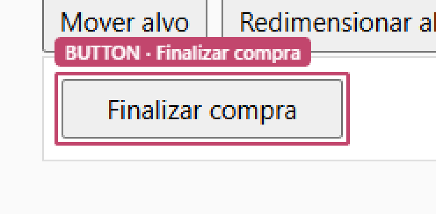
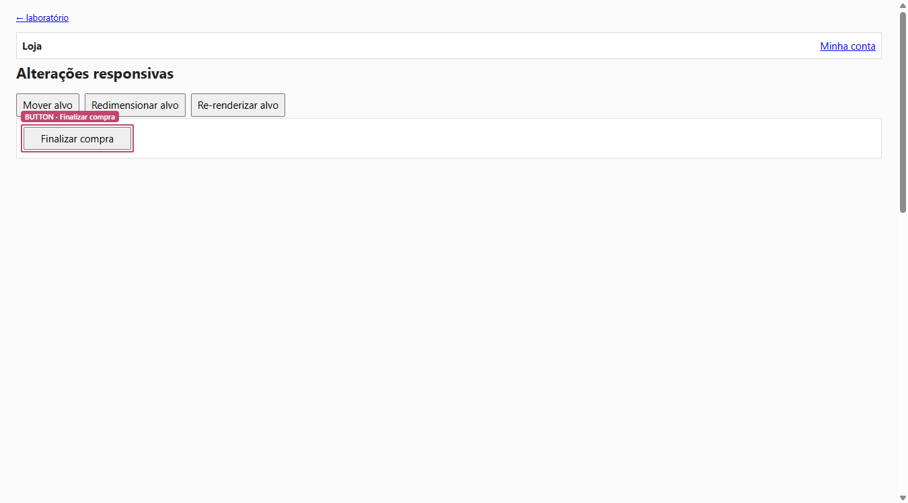
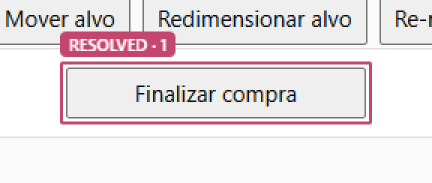
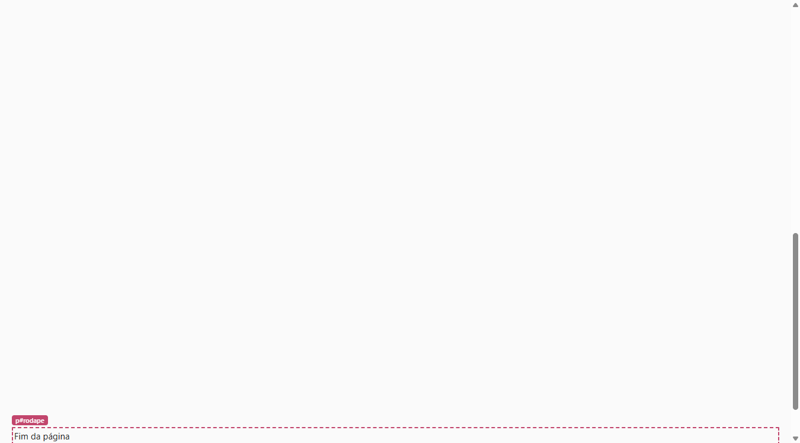
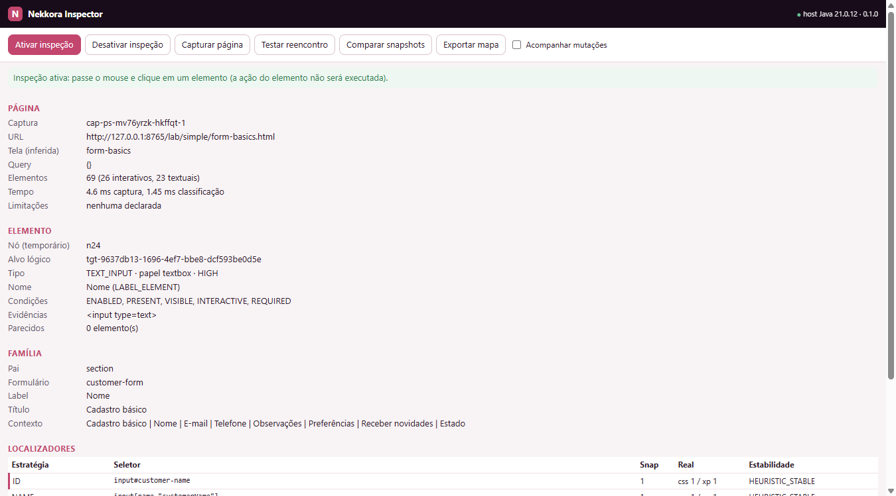
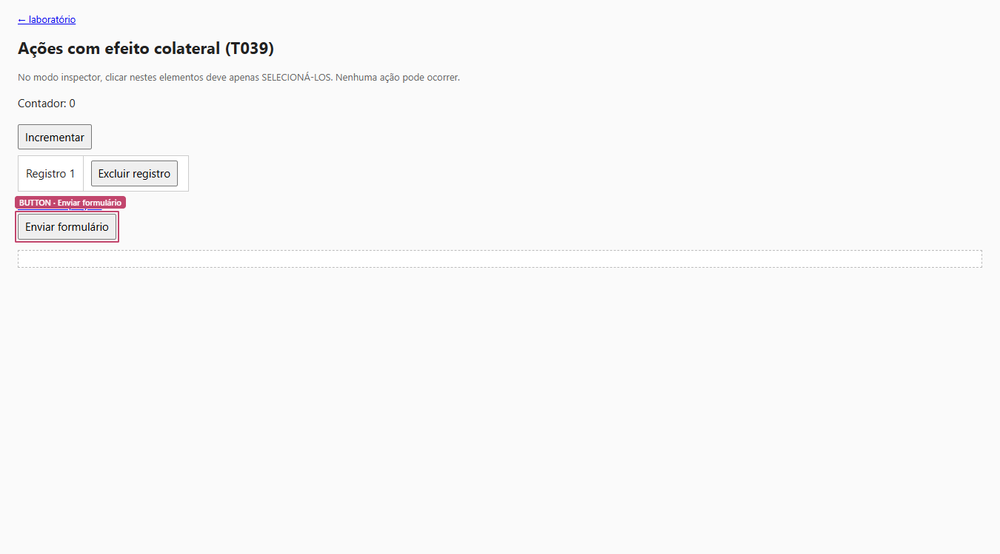

# Relatório de homologação — NEKKORA-CHROME-001

**Produto**: Nekkora Studio · **Componente**: Nekkora Extension Chrome · **Data**: 2026-10-13
**Ambiente**: Windows 11 · OpenJDK 21.0.12 · Chrome for Testing 155.0.8059.39 · Selenium 4.51 · Node 24.19
**Repositório**: `Nekkora-Operation/Nekkora-Extension-Chrome`

## 1. Resumo executivo

A extensão Chrome (MV3) e o motor Java 21 foram implementados e homologados **no navegador real**,
com o caminho completo página → content script → service worker → Native Messaging → processo Java
instalado pelo script oficial.

| Indicador | Resultado |
|---|---|
| Matriz obrigatória T001–T040 | **40/40 aprovados** |
| Casos negativos §23 (N-A..N-E) | **5/5 aprovados** (resultados de recusa corretos) |
| Comunicação, contrato real e interface (C-1..C-5, C-8 ×7, C-9) | **13/13 aprovados** |
| Total de homologação no Chrome | **58/58** ([matriz](test-matrix-integration.md)) |
| Testes sem navegador | **140/140** (113 motor, 12 host, 3 laboratório, 2 contrato, 10 extensão) |
| Orçamento de desempenho provisório | **atendido** em todas as métricas ([desempenho](performance.md)) |
| Testes reprovados, ignorados ou afrouxados | **nenhum** |

Homologação **completa** para o escopo local da missão, com as limitações declaradas na seção 6.

## 2. Arquitetura

- **Chrome**: captura estrutural somente leitura, rastreamento incremental de mutações, execução de
  localizadores na DOM real, destaque rosa por overlay, inspector com bloqueio de ações, painel lateral.
- **Java 21**: classificação semântica, grafo de contexto (família), localizadores com estabilidade,
  identidade lógica com discriminadores, resolução com 7 resultados, opções, navegação, deltas,
  interações, cobertura, PageMap 0.1.0 e persistência em JSON local.
- **Comunicação**: Native Messaging `nekkora-nm/1` com fragmentação nos dois sentidos.

Detalhes: [docs/architecture.md](../docs/architecture.md) · decisões: [docs/decisions.md](../docs/decisions.md).

## 3. Funcionalidades efetivamente existentes

| Requisito | Situação | Evidência |
|---|---|---|
| Captura da DOM acessível com estados coexistentes e limites | implementado | T018, T020, T027, C-8 |
| Classificação dos tipos exigidos (§7.2) com evidências/incertezas | implementado | `SemanticClassifierTest` (53), T001–T003, T028–T030 |
| Família (§8) inclusive IDs duplicados em tabelas/linhas | implementado | T004, T007, T008, `ContextGraphTest` |
| Textos próprio/descendente/acessível/contextual (§9) | implementado | T006, T028, `PageMapAssemblerTest` |
| Selects e componentes com opções (§10) | implementado | T010–T014, T021 |
| Localizadores múltiplos com contrato (§11) | implementado | T001–T008, concordância ao vivo |
| Reencontro e validação (§12) | implementado | T005, T009, T025, T026, T031, T040 |
| Destaque rosa #C2466D 2 px (§13) | implementado | T034, T035, T039, imagens abaixo |
| URL, SPA, query × consulta da interface × API (§14) | implementado | T022–T024 |
| Interações por clique e hooks controlados (§15) | implementado | T024, T038, T039 |
| Laboratório completo (§16–§18) | implementado | `test-lab/pages`, `lab-server` |
| Contrato PageMap versionado (§19) | implementado | `contracts/*.schema.json`, C-6..C-8 |
| PostgreSQL (§20) | não necessário (D-006) | — |
| Desempenho (§24) | medido | T036, T037 |
| Interface mínima (§26) | implementado | C-9 |

## 4. Testes

Resultado da execução final (`scripts/run-tests.ps1 -Suite all`, relatórios regenerados do zero):
ver [test-matrix-integration.md](test-matrix-integration.md) (gerado pelo próprio JUnit a partir da execução).

Falhas encontradas **durante** a homologação e corrigidas (todas com teste de regressão):

1. Chrome for Testing não lê `HKCU\Software\Google\Chrome for Testing` (lê `Software\Chromium`) — instalador corrigido.
2. Instalador quebrava no PowerShell 5.1 e gravava manifesto com BOM.
3. Divisão de pares substitutos entrava em laço infinito com fragmento mínimo (JS e Java).
4. Estabilidade observada nunca promovia `OBSERVED_STABLE`.
5. Recursão no cache de escopo dos localizadores.
6. Substituição de input por botão com o mesmo id não era detectada como `IDENTITY_MISMATCH`.
7. Chaves estruturais aceitavam semelhança parcial ("Endereço de cobrança" ≈ "Endereço de entrega").
8. `<form role="search">` deixava de ser formulário dos seus controles.
9. Lista irmã do controle era considerada portal.
10. Histórico de opções ignorava listas vazias (carregamento dinâmico 0 → N).
11. Widgets sem `:disabled` nativo eram marcados com estado desconhecido.
12. Exportação de 10.000 elementos levava 8,9 s → 3,3 s após otimização.

## 5. Desempenho

| Elementos | Captura | Bloqueio da página | Classificação Java | Ciclo captura | Reencontro | Localizador (média) | Export PageMap |
|---|---|---|---|---|---|---|---|
| 100 | 4,0 ms | 8,8 ms | 0,4 ms | 30 ms | 1,5 ms | 0,19 ms | 20 ms |
| 1.000 | 16,2 ms | 20,8 ms | 2,8 ms | 58 ms | 10,1 ms | 0,29 ms | 192 ms |
| 5.000 | 110,8 ms | 123,5 ms | 13,6 ms | 245 ms | 32,5 ms | 0,45 ms | 1.091 ms |
| 10.000 | 318,6 ms | 340,2 ms | 18,5 ms | 532 ms | 56,4 ms | 0,88 ms | 3.282 ms |

Mutações frequentes (relógio a cada 20 ms por 3 s): 513 registros brutos → 169 lotes → **7 deltas**,
processamento no host máx. 7,6 ms, sem ressincronização; estado incremental idêntico (em número de nós)
a uma captura completa. Fonte: [performance.md](performance.md).

## 6. Limitações

Lista completa: [docs/limitations.md](../docs/limitations.md). Principais: shadow DOM fechado e
iframes de outra origem declarados (não inspecionados); instalação automatizada validada só no
Windows; automação de testes no Chrome for Testing (Chrome de marca preparado para carga manual);
AccName simplificado; heurísticas rotuladas; shadow roots/iframes criados após ligar o rastreamento
exigem nova captura completa; licença pendente.

## 7. Reprodução

```powershell
git clone https://github.com/Nekkora-Operation/Nekkora-Extension-Chrome.git
cd Nekkora-Extension-Chrome
.\scripts\run-tests.ps1            # build + unitários + homologação no Chrome + relatórios
```

Uso manual: `scripts\build.ps1` → `native-host\scripts\install-host.ps1` → carregar `chrome-extension/`
em `chrome://extensions` → `scripts\start-lab.ps1` → painel *N* → *Ativar inspeção*.

## 8. Evidências visuais (Chrome real)

Destaque rosa de 2 px com afastamento de 2 px, sem alterar o layout (T034):



Página completa com o destaque e o rótulo do elemento:



Destaque acompanhando o novo nó após re-renderização (reencontro automático):



Modo inspeção (contorno tracejado ao passar o mouse):



Painel com elemento, família e localizadores verificados na DOM real (C-9):



Seleção em modo inspector sem disparar ações da página (T039):



## 9. Recomendações para a próxima missão

1. **Licença**: decidir o licenciamento antes de divulgar o repositório.
2. **Multiplataforma**: scripts de instalação do host para Linux/macOS e execução da matriz nesses sistemas.
3. **Iframes de outra origem permitida**: injetar content scripts por frame (`all_frames` com
   coordenação por `frameId`) para inspecionar frames de origens locais distintas.
4. **Rastreamento**: incluir no delta novos shadow roots/iframes (hoje exigem captura completa).
5. **Desempenho do PageMap**: exportação incremental/paginada e geração de localizadores sob demanda
   para páginas acima de 10.000 elementos; reduzir capturas retidas por aba (heap ~550 MB).
6. **Integração com o Studio**: consumir PageMap/TargetIdentity como contrato de entrada do motor de
   automação; definir política de "aprendizado" de identidade (assinatura hoje é fixa por segurança).
7. **AccName completo** (recursão de `aria-labelledby`, pseudo-elementos) e cálculo de papéis implícitos
   adicionais (ex.: `section` sem nome, `img` decorativa).
